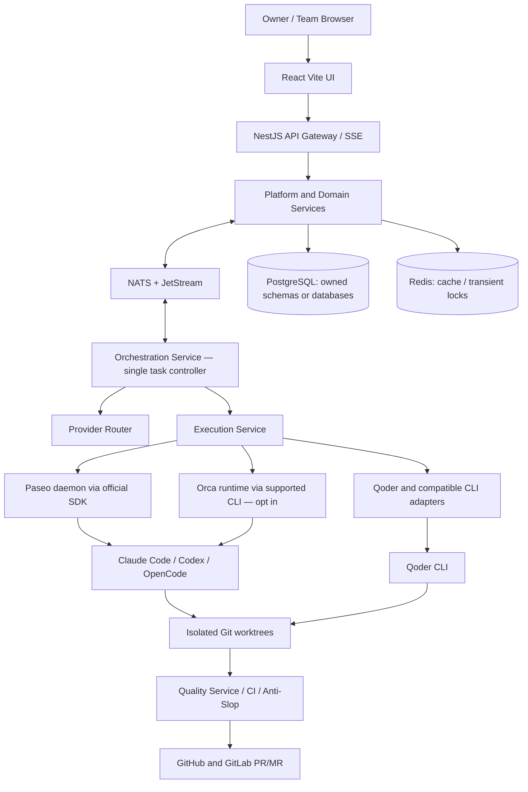
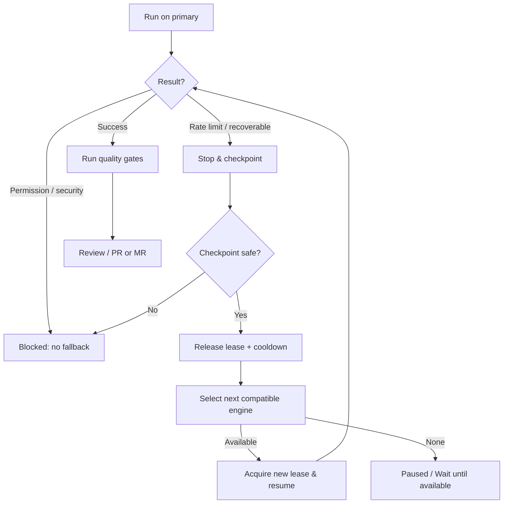

# PRODUCT REQUIREMENTS DOCUMENT (PRD)

# Quorumloop

### Open-source Autonomous AI Development Orchestration Platform

### Single Monorepo · 20 Microservices · GitHub/GitLab · Paseo/Orca · Claude/Codex/OpenCode/Qoder · Anti-Slop

> **Status:** Initial implementation-ready master PRD — architecture approved  
> **Tanggal:** 4 November 2026  
> **Bahasa produk:** Antarmuka Bahasa Inggris (default), arsitektur siap i18n Bahasa Indonesia  
> **Tipe distribusi:** Self-hosted, open-source, local-first  
> **Target deployment awal:** Ubuntu/Linux home server dan laptop developer, melalui Docker Compose (core/full/demo profiles)  
> **Target pengguna:** Solo maker, developer, dan tim kecil yang ingin mengelola beberapa proyek serta banyak AI coding agents.  
> **Nama produk:** Quorumloop. **Dokumen ini adalah sumber requirement tunggal untuk memulai implementasi.**
> **Architecture decisions are binding:** React + Vite, NestJS + Fastify, **NestJS-idiomatic Clean Architecture + selective CQRS**, Node.js 26 LTS, pnpm + Turborepo, 20 microservices dalam SATU monorepo, NATS JetStream, PostgreSQL/Drizzle, Redis, Docker Compose, Kubernetes-ready.

---

## 0. INSTRUKSI WAJIB UNTUK AI IMPLEMENTATION AGENT — BACA TERLEBIH DAHULU

**Misi:** Bangun aplikasi _Quorumloop_ yang nyata, self-hostable, aman, dan siap menjadi repository open-source publik. Bukan demo visual semata, bukan static mockup, dan bukan dashboard yang memalsukan status agent / commit / token / testing.

**Perintah eksekusi:**

1. Baca keseluruhan PRD ini sebelum melakukan perubahan besar. Bangun dalam fase yang terukur; prioritaskan _vertical slice_ yang benar-benar berfungsi. Scaffold 20 service di awal dalam satu monorepo, tetapi jangan menyebut scaffold sebagai layanan selesai.
2. **Sebelum membuat UI**, pasang atau rujuk skill resmi [Anti-Slop](https://github.com/miqdadbadjuber/anti-slop) yang kompatibel, baca aturannya, lalu tulis **`DESIGN.md`** yang spesifik untuk produk ini. Anti-Slop adalah filter kualitas, bukan sumber arah visual.
3. Bangun integrasi **GitHub dan GitLab**, lalu **Paseo SDK**; tambah **Orca** sebagai runtime/adapter terpisah. Jangan mengganti requirement dengan mock-only tanpa menyatakannya secara jelas.
4. Daftarkan empat _coding engines_: **Claude Code, OpenAI Codex, OpenCode, Qoder CLI**. Konfigurasi kemampuan berdasarkan _capability detection_, bukan menganggap semuanya identik. Qoder tidak boleh diam-diam dipetakan menjadi produk "Coder".
5. Buat **provider routing priority, quota/rate-limit fallback, durable checkpoints, workspace isolation**, dan _audit trail_. Fallback hanya berpindah melalui integrasi yang resmi dan berizin; jangan mencoba mengakali pembatasan layanan.
6. Gunakan **Node.js 26 LTS + React/Vite + NestJS/Fastify**, 20 microservices terpisah, **NestJS Modules/Providers + Clean Architecture + CQRS selektif**, NATS JetStream, PostgreSQL/Drizzle, Redis, pnpm/Turborepo; **jangan mengganti dengan Next.js atau modular monolith** tanpa keputusan tertulis baru.
7. Buat **AI Product Lead** untuk menyusun ide, PRD singkat, backlog, sprint, dependency, delegasi, dan mengusulkan iterasi. Keputusan rutin boleh otomatis sesuai policy; keputusan berisiko harus ada batasnya.
8. Implementasi **task ownership** tunggal: satu task hanya boleh memiliki satu _active executor lease_; Paseo dan Orca **tidak** boleh menjalankan task yang sama bersamaan.
9. Jangan lakukan deploy production, menghapus data non-ephemeral, mengeluarkan biaya, mengubah konfigurasi keamanan, membuat repo publik, atau auto-merge ke branch terlindungi tanpa izin eksplisit dari pemilik deployment.
10. Wajib gunakan _feature flags_: jika suatu integrasi belum terkonfigurasi, tampilkan status **Not connected / Unsupported / Experimental**, bukan data rekaan.
11. Buat test untuk workflow kritis, siapkan contoh `.env.example`, Docker Compose, README, docs self-hosting, dan dokumen open-source. Jangan commit secrets, token, file perusahaan, maupun data pengguna.
12. Laksanakan tiap fase, uji, catat hasil, perbaiki kegagalan, lalu lanjut ke task dependensi berikutnya. Bila provider limit, buat checkpoint lalu tunggu cooldown/beralih menurut policy. Jangan infinite retry. Jangan menyatakan "done" tanpa bukti.
13. Jika kemampuan library belum cocok dengan dokumentasi versi terpasang, cek API aktual dan buat adapter/fallback yang eksplisit; **jangan mengarang method SDK**.
14. Setiap PR harus punya: _scope_, bukti test, laporan Anti-Slop PASS/FAIL, perubahan DB jika ada, risiko, dan langkah rollback.
15. Gunakan kualitas kode yang dapat dipelihara oleh kontributor publik: typing kuat, modular, migrasi database, logging terstruktur, API contracts, dan dokumentasi.
16. **Jangan berhenti pada desain**: prioritaskan aplikasi yang bisa login, mengimpor repo, menampilkan commit nyata, membuat task, menjalankan setidaknya satu agent nyata, memantau status, dan menghasilkan PR/MR.

### Definition of Done (DoD) global

- Seluruh acceptance criteria P0 yang aktif lulus tes otomatis dan tes manual berbukti.
- Tidak ada UI control palsu atau hasil agent semu pada mode connected.
- Semua data demo ditandai **Demo**, tersedia hanya ketika pengguna memilih demo mode.
- Anti-Slop Delivery Gate selesai; masalah blocking diselesaikan.
- Secret scan dan dependency/license checks lulus.
- Dokumentasi instalasi untuk orang lain dapat diikuti tanpa akun/credential pembuat aplikasi.
- Jika sesuatu belum selesai, sebutkan jujur di `KNOWN_LIMITATIONS.md` dan tandai dengan status yang akurat pada aplikasi.

---

## 1. PRODUCT VISION

> **Satu dashboard untuk mengubah ide menjadi produk, mengelola banyak project GitHub/GitLab, menjalankan AI development team, memantau tiap agent, serta mengirim instruksi revisi langsung dari browser.**

Pengguna bisa memiliki 8 proyek, 20 proyek, atau lebih dalam satu instalasi. Contoh: Nodezio, Family OS, Karyalokart, Al-Muhyt. Masing-masing proyek mempunyai repository, backlog, agent sessions, history perubahan, quality gates, dan provider priority yang terisolasi secara logis. **Tidak ada limit keras 8**; angka 8 hanya contoh use case.

**Masalah yang diselesaikan**

- Proyek tersebar di banyak repository, terminal, branch, dan tools AI.
- Sulit mengetahui agent mana sedang mengerjakan apa dan apakah hasilnya sungguh lolos testing.
- Ide aplikasi belum memiliki rancangan produk, prioritas fitur, atau roadmap.
- Provider AI punya kuota/keterbatasan yang berbeda; ketika satu berhenti, konteks tugas sering hilang.
- Hasil UI AI cenderung generik, tidak memiliki identitas, dan sering lolos tanpa audit visual/accessibility.
- Solo developer ingin otomasi tetapi tetap membutuhkan guardrail untuk biaya, keamanan, data, dan deploy.

### Sasaran

1. Mengelola multi-project lintas GitHub/GitLab dari satu browser, termasuk repository privat yang diizinkan.
2. Mengubah ide mentah menjadi proposal MVP, PRD ringkas, backlog, dependency graph, sprint, dan implementasi.
3. Menjalankan Claude Code, Codex, OpenCode, dan Qoder dengan routing prioritas dan fallback aman.
4. Menyediakan dua lapis runtime: **Paseo** untuk kontrol agent dan workflow product lead; **Orca** untuk eksekusi worktree/worker paralel ketika mendukung dan diaktifkan.
5. Memberi observability nyata: task, agent, output, logs redacted, commits, PR/MR, build/test, blockers.
6. Membuat kualitas UI, copy, accessibility, dan code review konsisten dengan Anti-Slop + `DESIGN.md` per project.
7. Membuat aplikasi dapat di-fork, dijalankan, diaudit, dan dikembangkan orang lain secara profesional.

### Bukan sasaran (non-goals)

- Bukan penjualan API key, kuota AI, atau proxy untuk berbagi langganan individu.
- Bukan bypass rate limit atau pengelakan Terms of Service vendor.
- Bukan produk yang menjamin app selalu selesai tanpa intervensi.
- Bukan pengganti GitHub/GitLab CI, repos, atau official code hosting.
- Bukan reproduksi source code, merek, UI, atau aset Paseo/Orca/Qoder tanpa mengikuti ketentuan pemiliknya.
- Tidak membolehkan akses root host, Docker socket, maupun kredensial SSH host tanpa perlindungan eksplisit.

---

## 2. PERSONA & SKENARIO UTAMA

### Persona

- **Owner / Maker:** memberi ide aplikasi, memilih project, memantau progress, mengirim revisi, melihat deliverables.
- **Developer / Collaborator:** membuat task, mengecek diff, review PR/MR, memonitor agent, menangani konflik.
- **Instance Admin:** mengatur runtime, koneksi Git, provider account, security policy, budget, workspace, release.
- **AI Product Lead:** mengusulkan fitur/roadmap, menyusun prioritas, membuat task, meminta agent menilai solusi.
- **AI Developer / Reviewer:** mengeksekusi task sesuai scope, menulis test, memberi bukti, melakukan code review.

### Core journeys

**A. Import Nodezio dari GitHub** → Connect GitHub → select repo → pilih branch dasar → safe clone → analisis repo read-only → backlog awal → project detail dengan commits/PR/tasks → buat instruksi revisi → agent bekerja di branch/worktree terpisah → test → PR → review.

**B. Import repo dari GitLab** → Connect GitLab → select project → branch/MR/pipeline yang relevan → daftar task dan agent → revision → merge request.

**C. Start From Idea** → tulis "buat aplikasi keuangan keluarga" → Product Lead menulis assumptions + discovery → MVP/spec + `DESIGN.md` proposal → backlog & milestone → create repo (hanya setelah izin awal) → implementasi iteratif → QA → demo/review.

**D. Provider limit** → Claude Code rate limited → task checkpoint/commit safe state → scheduler cek candidate sesuai policy dan kemampuan → pindah Codex / OpenCode / Qoder atau tunggu cooldown → agent berikut membaca handoff → resume task tanpa double execution.

**E. Multi project** → satu instance dengan 8 repos → satu project dapat 3 agent, yang lain idle → resource caps mencegah 8 repos mengeksekusi build simultan tanpa batas.

**F. Self-host oleh rekan kantor** → clone repo publik → `.env.example` → `docker compose up` → setup admin → sambungkan repo dan akun pribadi → perangkat tidak membutuhkan secret atau kredensial author.

---

## 3. ARSITEKTUR TERKUNCI — SINGLE MONOREPO, TRUE MICROSERVICES

### 3.1 Aturan arsitektur yang tidak boleh ditawar

1. **SATU repository Git saja** (`quorumloop`), **bukan** 20 repository. Setiap service berada di folder sendiri dalam monorepo dan punya build/test/image/deployment sendiri.
2. **20 microservices sejak blueprint pertama**: 20 service boundary definitif. Implementasi secara bertahap (vertical slice) tanpa mengganti arsitektur menjadi modular monolith sementara. Tidak semua container harus selalu hidup di laptop developer.
3. **Satu public API Gateway**. Browser tidak berbicara langsung dengan data store, NATS, Paseo daemon, Orca runtime, atau runner.
4. **Per-service data ownership.** Boleh satu cluster PostgreSQL pada tahap awal, tetapi database atau schema dan DB user terpisah per service; **tidak boleh cross-service direct query/join** dan tidak boleh foreign key lintas schema ownership. Entitas lintas domain ditautkan dengan identifier stabil dan API/event.
5. **NestJS-native layering:** `Modules` mengikat dependency melalui `Providers`/DI; `presentation` berisi HTTP controllers dan NATS message handlers, `application` berisi use cases (dan Command/Query Handlers hanya bila kompleks), `domain` berisi model/invariants/events, `infrastructure` berisi adapters Drizzle, Git, NATS, dan vendor AI. Dependency source code harus mengarah ke dalam; akses DB tidak boleh berada di controller/handler transport. Jangan membuat shared data-access library yang melintasi ownership service.
6. **Service dependencies tidak membuat shared domain object mutable.** Packages bersama hanya contracts/schema/types, UI primitives, logging, test tools, config, dan utilities netral; business logic tetap milik service.
7. **Orchestration-service satu-satunya Task Controller**: penugasan, lease, fencing, runtime selection, retry, stop, recovery. Paseo/Orca merupakan adapters untuk eksekusi agent, tidak boleh mengklaim ownership task yang sama.
8. **NATS JetStream untuk durable events**, Core NATS untuk request/reply dan ephemeral signals bila layak. NestJS built-in NATS transport **tidak otomatis** membuat pesan durable: gunakan JetStream client dan explicit ACK/consumer configuration untuk event kritis.
9. At-least-once events membutuhkan **transactional outbox + idempotent inbox** dan consumer deduplication. Anggap event dapat tiba lebih dari sekali / terlambat / tidak berurutan.
10. Semua integrasi coding agent menjalankan kode dalam workspace terisolasi; tidak ada akses root / Docker socket host dari untrusted agent secara default.

### 3.2 Topologi high-level



### 3.3 Microservices inventory — tepat 20 logical services

|   # | Domain          | Deployable service / folder | Batas ownership                                                                                              |
| --: | --------------- | --------------------------- | ------------------------------------------------------------------------------------------------------------ |
|  01 | Platform        | `api-gateway`               | REST v1, session boundary, authorization enforcement, API aggregation, SSE; **no business DB**               |
|  02 | Platform        | `identity-service`          | users, organization memberships, roles, sessions, auth, access control claims                                |
|  03 | Platform        | `project-service`           | project lifecycle, project metadata, project-to-repo binding, project onboarding state                       |
|  04 | Platform        | `settings-service`          | org/project policy, autonomy rules, feature flags, configuration versions                                    |
|  05 | Platform        | `notification-service`      | in-app notifications, outbound delivery policy, optional e-mail/Telegram adapters                            |
|  06 | Git & Workspace | `source-control-service`    | GitHub/GitLab connection records, repository references, commit/branch/PR/MR cache, reconciliation           |
|  07 | Git & Workspace | `webhook-service`           | signatures, webhooks ingestion, delivery dedup, external → internal normalized events                        |
|  08 | Git & Workspace | `workspace-service`         | checkout/worktree lifecycle, path guard, cleanup, artifacts, filesystem ownership                            |
|  09 | AI              | `agent-control-service`     | agent sessions, role profiles, live statuses, timeline index, prompt/action request provenance               |
|  10 | AI              | `provider-registry-service` | Claude/Codex/OpenCode/Qoder readiness, capabilities, provider metadata, account health (never share secrets) |
|  11 | AI              | `provider-router-service`   | priority routing, limit cooldown, circuit breaker, policy-aware fallback decision                            |
|  12 | AI              | `orchestration-service`     | task ownership, distributed execution leases, fencing tokens, workflow runs, recovery, coordination          |
|  13 | AI              | `execution-service`         | trusted runner handoff, Paseo/Orca/Qoder runtime adapters, process lifecycle, sandbox execution              |
|  14 | AI              | `product-planning-service`  | idea discovery, PRD proposal, roadmap, sprint suggestions, autonomous Product Lead workflows                 |
|  15 | AI              | `scheduler-service`         | scheduled runs, heartbeat checks, backlog wake-ups, retry requeue under limits                               |
|  16 | Management      | `task-service`              | epics, task backlog, Kanban, dependencies, task state, assignment metadata                                   |
|  17 | Management      | `quality-service`           | build/test/CI evidence, Anti-Slop gate, accessibility and security/quality outcomes                          |
|  18 | Management      | `activity-service`          | sanitized user activity streams, project feed, timeline cursors, status projections                          |
|  19 | Management      | `usage-service`             | usage/latency/cost telemetry **when exposed**, quota estimates labeled accordingly, resource budgets         |
|  20 | Management      | `audit-service`             | immutable-ish administrative audit trail, sensitive approval history, retention policy                       |

**Service count = 5 + 3 + 7 + 5 = 20.** Backend service names are the deployable boundaries. You can add Nest modules _within_ a service, but do not split one service into many deployed processes without an ADR and migration plan. New service must justify data ownership, independent scaling, failure isolation and operations cost.

**Important detail:** `api-gateway` adalah service ke-01, bukan service ke-21. Frontend di `apps/web` **bukan** microservice backend ke-21. Infrastructure seperti NATS, PostgreSQL, Redis, agent-runner hosts juga bukan anggota daftar 20.

### 3.4 Contoh request end-to-end: pengguna meminta revisi Nodezio

1. Browser mengirim `POST /api/v1/projects/{id}/instructions` kepada `api-gateway` dengan idempotency key.
2. `task-service` menyimpan task/acceptance criteria; `audit-service` mencatat instruksi user dan policy context.
3. `orchestration-service` memvalidasi dependency serta batas concurrency, kemudian mengunci task melalui **fenced lease** atomik; menerbitkan `execution.requested.v1` via outbox.
4. `provider-router-service` mengecek urutan provider, capability, permission, rate limit, budget, dan status runtime; mengembalikan hasil keputusan serta alasan transparan.
5. `workspace-service` membuat worktree aman dari commit basis, memasang branch sesuai konvensi, merekam checksum dan ACL.
6. `execution-service` memilih **satu** runtime: Paseo **atau** Orca **atau** direct Qoder adapter; meminta adapter mengerjakan task dan mencatat external session id.
7. Status/progress dan redacted event dinormalisasi ke `agent-control-service` dan `activity-service`; UI mendapat SSE update (reconnect via cursor).
8. `quality-service` menjalankan test, lint, security, Anti-Slop + DESIGN.md audit, menyimpan bukti. Gagal → task dikembalikan dengan findings; lulus → `source-control-service` membuat/menautkan PR/MR apabila policy mengizinkan.
9. `task-service` menandai selesai **hanya setelah DoD terpenuhi**; `audit-service` menyimpan event final; Product Lead boleh membuat task berikutnya sesuai autonomy policy.

### 3.5 Sync vs async communication

- **HTTP internal / versioned contracts:** reads/commands yang memerlukan jawaban langsung, dengan timeout, service auth, tracing, dan strict error semantics. Hindari request chain panjang.
- **NATS Core:** request/reply atau ephemeral notifications bila pesan hilang masih dapat direkonsiliasi.
- **NATS JetStream:** durable `*.requested`, `*.completed`, `*.failed`, `*.changed` dan events penting. Gunakan durable pull consumers, explicit ACK setelah local commit, retry bounded, dead-letter/quarantine subject.
- **Database outbox:** producer menulis state + outbox dalam transaksi sama, publisher mengirim event secara idempotent; consumer inbox mendeteksi duplikat; semua state machine harus re-entrant.
- **Redis:** cache, ephemeral rate guard dan ephemeral projection, bukan satu-satunya penyimpanan task/leases/durable logs; authoritative lease state disimpan transaksional di PostgreSQL.

### 3.6 Ownership & cross-service policy

- `project-service` tidak boleh `SELECT` pada schema `task-service`; gunakan service API atau materialized read model berbasis events.
- `source-control-service` mengelola commit/PR status sebagai **remote mirror/cache**; GitHub/GitLab tetap authoritative untuk Git.
- `task-service` authoritative untuk Kanban, bukan Paseo session status. `agent-control-service` authoritative untuk normalized execution/session state, bukan remote Git commits.
- `orchestration-service` owns execution_attempt lease; `workspace-service` owns physical filesystem/worktree lifecycle; keduanya sinkron melalui explicit commands/events.
- `usage-service` tidak boleh menampilkan anggaran langganan sebagai real-time quota kecuali ada API resmi yang benar-benar menyediakannya.

### 3.7 Horizontal scale, degraded mode, failure isolation

- Gateway stateless, horizontal replicas behind reverse proxy; ensure SSE sticky strategy **atau** shared event fanout.
- Consumer queue groups and runner pool scale per domain; NATS stream retention/storage quotas and backpressure documented.
- Orca tidak tersedia → Paseo-only. Qoder tidak tersedia → route ke eligible engine lain. GitLab belum connected → fitur GitHub tetap berjalan.
- `api-gateway` startup tidak memerlukan semua 19 service healthy untuk menyajikan UI shell; fitur yang down menampilkan _degraded_ dengan status nyata.
- Runtime crash/restart → lease expiry, stale executor fencing, checkpoint verification before any replay.

### 3.8 Mandatory architecture decision records

Buat `docs/adr/` minimal: ADR-001 monorepo, ADR-002 20 domain boundaries, ADR-003 Node26/NestJS, ADR-004 NATS JetStream, ADR-005 Postgres ownership, ADR-006 runner isolation, ADR-007 Paseo primary/Orca opt-in, ADR-008 provider fallback/checkpoints, ADR-009 license strategy, ADR-010 web UX Anti-Slop direction, **ADR-011 NestJS Clean Architecture, feature modules, dan kebijakan CQRS selektif**.

---

## 4. FINAL STACK, RUNTIME, REPOSITORY STRUCTURE DAN CODE STYLE

### 4.1 Technical choices (LOCKED)

| Layer            | Keputusan final                                                                               | Engineering notes                                                                                                                                 |
| ---------------- | --------------------------------------------------------------------------------------------- | ------------------------------------------------------------------------------------------------------------------------------------------------- |
| Frontend         | **React + Vite + TypeScript strict**                                                          | Single-page application berbasis auth; static build via nginx/Caddy, no React + Vite dependency                                                   |
| UI               | Tailwind CSS + accessible headless components (Radix/shadcn primitives if license-compatible) | **Original design system** via `DESIGN.md`; don't ship generator-default UI                                                                       |
| Frontend state   | TanStack Router + TanStack Query                                                              | URL-driven tabs, query caching, SSE invalidation, error boundary                                                                                  |
| Backend          | **NestJS + Fastify adapter**                                                                  | Idiomatic Modules, Controllers, injectable Providers, Guards/Pipes/Interceptors/Filters; per-service Clean Architecture; selective `@nestjs/cqrs` |
| Runtime          | **Node.js 26 LTS** (pin exact tested patch in Docker/CI)                                      | `engines.node` 26.x; pin versions, no forced Bun/Deno switch                                                                                      |
| Language         | **TypeScript strict**                                                                         | No unchecked `any`, explicit DTO/schema and typed errors                                                                                          |
| Monorepo         | **pnpm workspace + Turborepo**                                                                | One lockfile and one `.git`, per-service cache/build targets                                                                                      |
| Event bus        | **NATS + JetStream**                                                                          | Durable messages use JetStream library, not only basic Nest NATS transporter                                                                      |
| Database         | **PostgreSQL + Drizzle ORM**                                                                  | Per-service owned DB/schema, migrations, independent credentials                                                                                  |
| Cache            | **Redis**                                                                                     | Cache and transient state; no critical durable state only in Redis                                                                                |
| Realtime         | SSE API Gateway                                                                               | Agent streams normalized server-side; no direct daemon WebSocket exposed to public browser                                                        |
| Auth             | httpOnly cookie sessions + role-based access                                                  | CSRF/origin checks, local admin bootstrap; OIDC optional later                                                                                    |
| Git              | GitHub App + GitLab OAuth/token                                                               | Least privilege and webhook signatures; support GitLab.com first                                                                                  |
| Orchestration    | **Paseo SDK `@getpaseo/client`**                                                              | Product Lead and agent lifecycle; public SDK only                                                                                                 |
| Parallel runtime | **Orca CLI**                                                                                  | Optional and experimental depending local version; feature detect                                                                                 |
| Engines          | Claude Code, Codex, OpenCode, Qoder CLI                                                       | BYO login/secrets, policy-bound priority/fallback                                                                                                 |
| Runner           | Non-root isolated Linux container/job/VM                                                      | Executor-specific permissions, no host Docker socket or credential sharing                                                                        |
| Testing          | Vitest, Playwright, API integration, contract tests, axe                                      | CI validation, chaos/failure recovery test                                                                                                        |
| Observability    | OpenTelemetry-compatible traces, metrics, structured logs                                     | correlation IDs across gateway/events, redaction everywhere                                                                                       |
| Deployment       | Docker Compose core/full profiles; Helm/K8s-ready manifests                                   | one source code repository, independent release images                                                                                            |

**Why Node.js not Bun for P0:** Node26 LTS offers a tested common baseline for NestJS, SDK integrations, process control, debugging and contributors. Bun can be evaluated later for a specific service via ADR + integration benchmarks, never switch without cross-provider compatibility and security checks.

### 4.2 Required monorepo tree

```text
quorumloop/
├── apps/
│   └── web/                            # React + Vite frontend (not a backend microservice)
├── services/
│   ├── api-gateway/
│   ├── identity-service/
│   ├── project-service/
│   ├── settings-service/
│   ├── notification-service/
│   ├── source-control-service/
│   ├── webhook-service/
│   ├── workspace-service/
│   ├── agent-control-service/
│   ├── provider-registry-service/
│   ├── provider-router-service/
│   ├── orchestration-service/
│   ├── execution-service/
│   ├── product-planning-service/
│   ├── scheduler-service/
│   ├── task-service/
│   ├── quality-service/
│   ├── activity-service/
│   ├── usage-service/
│   └── audit-service/
├── packages/
│   ├── contracts/                     # public versions of DTO/event contracts only
│   ├── config/                        # safe typed configuration primitives
│   ├── observability/                 # tracing, logging, redaction hooks
│   ├── testing/                       # cross-service test fixtures, contract harness
│   ├── ui/                            # reusable accessibility-safe components
│   └── tooling/                       # lint, TS, build presets
├── infrastructure/
│   ├── compose/
│   │   ├── compose.core.yml
│   │   └── compose.full.yml
│   ├── docker/                         # per-service Dockerfiles or shared audited base
│   ├── nats/                           # streams, consumers, limits, DLQ definitions
│   ├── postgres/                       # per-service role/schema bootstrap
│   ├── redis/
│   ├── k8s/                            # optional Helm charts after Compose parity
│   └── reverse-proxy/
├── scripts/                             # safe setup, verification, smoke tests
├── docs/
│   ├── adr/
│   ├── architecture/
│   │   ├── service-catalog.md
│   │   ├── dependencies.md
│   │   ├── event-catalog.md
│   │   ├── data-ownership.md
│   │   ├── authz-matrix.md
│   │   └── diagrams/
│   ├── development.md
│   ├── self-hosting.md
│   ├── integration-guide.md
│   ├── backup-restore.md
│   ├── runbooks/
│   ├── attribution.md
│   └── release-checklist.md
├── .github/                             # CI, templates, codeowners, security workflows
├── DESIGN.md
├── AGENTS.md
├── PRD_QUORUMLOOP.md
├── .env.example
├── pnpm-workspace.yaml
├── turbo.json
├── package.json
├── pnpm-lock.yaml
├── LICENSE
├── NOTICE
├── THIRD_PARTY_NOTICES.md
├── CONTRIBUTING.md
├── CODE_OF_CONDUCT.md
├── SECURITY.md
├── CHANGELOG.md
├── DISCLAIMER.md
├── README.md
└── KNOWN_LIMITATIONS.md
```

### 4.3 Mandatory NestJS-native Clean Architecture + selective CQRS

**Aturan penamaan:** gunakan nama yang memang idiomatik di ekosistem NestJS (`*.module.ts`, `*.controller.ts`, injectable providers, `*.guard.ts`, `*.pipe.ts`, `*.interceptor.ts`, `*.filter.ts`). Ini **bukan** struktur Laravel yang ditransplantasi. Tidak perlu folder generik `Support/`, `Helpers/`, atau mewajibkan `*.service.ts`/`*.repository.ts` untuk setiap use case. `Service` dan `Repository` boleh digunakan bila secara teknis tepat, tetapi bukan satu-satunya pola.

**Empat lapisan dan dependensinya:**

1. **Presentation / transport:** Nest HTTP controllers, NATS message controllers, guards, pipes, DTOs, serialization. Pemetaan input/output, auth, dan validation; **tanpa** query Drizzle, domain workflow, atau pemanggilan vendor langsung.
2. **Application:** use-case providers dan workflow orchestration. Untuk use case kompleks gunakan `@nestjs/cqrs` dengan `Command`, `Query`, `CommandHandler`, `QueryHandler` dan, bila masuk akal, `EventHandler`/sagas. Untuk CRUD sederhana gunakan injectable use-case provider tanpa ceremony CQRS.
3. **Domain:** entities, value objects, domain policies, invariants, dan domain events murni TypeScript. **Tidak mengimpor NestJS, Drizzle, NATS, HTTP, atau vendor SDK.**
4. **Infrastructure:** implementasi outbound ports (PostgreSQL/Drizzle persistence adapters, NATS publisher/subscriber adapters, GitHub/GitLab/Paseo/Orca/Qoder API adapters). Implementations didaftarkan dengan DI tokens di Nest modules; aplikasi berinteraksi melalui ports, bukan concrete SDK.

Dependency direction: `presentation → application → domain`; `infrastructure → application/domain contracts` dan NestJS module composition menghubungkan port ke implementasi. Framework modules menjadi _composition root_; dependency domain **tidak pernah** mengarah ke framework atau infrastructure. Read model CQRS boleh menggunakan dedicated query port, tetapi tetap mematuhi ownership database service.

**Contoh struktur `project-service`:**

```text
services/project-service/
├── src/
│   ├── main.ts
│   ├── app.module.ts
│   ├── projects/
│   │   ├── projects.module.ts                # DI composition / providers / imports
│   │   ├── presentation/
│   │   │   ├── http/
│   │   │   │   └── projects.controller.ts   # Nest controller: map/validate only
│   │   │   ├── messaging/
│   │   │   │   └── project-events.controller.ts
│   │   │   └── dto/
│   │   ├── application/
│   │   │   ├── use-cases/
│   │   │   │   └── update-project.use-case.ts # simple flows can use providers
│   │   │   ├── commands/
│   │   │   │   ├── create-project.command.ts
│   │   │   │   └── handlers/
│   │   │   │       └── create-project.handler.ts
│   │   │   ├── queries/
│   │   │   │   ├── get-project.query.ts
│   │   │   │   └── handlers/
│   │   │   │       └── get-project.handler.ts
│   │   │   └── ports/
│   │   │       ├── project-store.port.ts
│   │   │       └── event-publisher.port.ts
│   │   ├── domain/
│   │   │   ├── entities/
│   │   │   ├── value-objects/
│   │   │   ├── policies/
│   │   │   └── events/
│   │   └── infrastructure/
│   │       ├── persistence/
│   │       │   ├── drizzle-project-store.adapter.ts
│   │       │   └── schema.ts
│   │       ├── messaging/
│   │       │   └── nats-event-publisher.adapter.ts
│   │       └── integrations/
│   └── health/
├── migrations/
├── test/unit/
├── test/integration/
├── test/contract/
├── Dockerfile
├── package.json
├── tsconfig.json
└── README.md
```

**CQRS selection policy (must follow):**

| Use case                                                                       | Default implementation                                                        | When CQRS is justified                                                        |
| ------------------------------------------------------------------------------ | ----------------------------------------------------------------------------- | ----------------------------------------------------------------------------- |
| Simple settings CRUD, health/readiness, straightforward lookups                | Nest provider/use-case, conventional controller                               | Not needed by default                                                         |
| Project creation with validations, outbox, quota/policy, external side effects | `CreateProjectCommand` + `CommandHandler`                                     | Yes, multi-step transactional business flow                                   |
| Complex Kanban queries, agent timeline aggregation, auditing read models       | `Query` + `QueryHandler` + query port                                         | Yes, distinct read shape/reliability needs                                    |
| Agent dispatch/lease/checkpoint/fallback workflow                              | Commands/handlers, state machine and explicit ports                           | Yes, critical coordinated writes                                              |
| Domain event reaction to durable JetStream events                              | Message handler + application command; domain event handler where appropriate | Only if it improves clarity; never assume `@nestjs/cqrs` event bus is durable |

**Non-negotiable engineering constraints:**

- CQRS is **selective**, not mandatory for all services, routes or reads. Do not introduce empty handler classes, interfaces, adapters or event types to satisfy a naming checklist.
- `@nestjs/cqrs` **is in-process application dispatch**, not a replacement for inter-service NATS JetStream or the transactional outbox/inbox pattern.
- Nest transport decorators remain in presentation; DTOs never leak as domain models; framework exceptions are mapped at boundary.
- Persistence ports/interfaces are owned by the use case's service. Drizzle adapters implement those contracts without being imported by domain or application files. Database/schema ownership is strictly enforced by service DB users.
- Ports may be TypeScript interfaces plus explicit injection symbols/tokens; do not inject erased interfaces at runtime without a DI token/provider binding.
- Cross-service interactions go through versioned API clients or NATS contracts; never import another service's internal module, entity or Drizzle schema.
- Add architecture tests/ESLint module-boundary rules verifying the dependency direction and absence of forbidden imports. Use unit tests for handlers, integration tests for adapters, contract tests for NATS/API.
- The code generation/scaffolding templates for **all 20 services** must follow these conventions, adjusted pragmatically for stateless gateway and adapter-only workers.

### 4.4 Contributor ergonomics

- Root `pnpm install` installs workspace; `pnpm dev:web`, `pnpm dev:core`, `pnpm dev:full`, `pnpm test`, `pnpm test:contracts`, `pnpm lint`, `pnpm typecheck` must be documented and implemented.
- `pnpm --filter <service> test` and `docker compose --profile <mode> up` work for any service.
- Per-service semantic version / package artifact metadata + shared release manifest; single Git repo and optionally one coordinated product release tag.
- Use `CODEOWNERS`, service-level README (purpose/owner/events/apis/data/ports/deps/health/migrations), CI affected-service detection via Turborepo.
- Multi-service changes must include compatibility tests and documented migration order. No direct import `services/another-service/src/**`.
- Each service ships readiness, liveness, metrics, tracing, structured logs, graceful shutdown and independent DB migration.
- All entrypoints use timezone-aware UTC storage and Asia/Makassar display optional via user preferences; no naive system time comparisons.

---

## 5. INFORMATION ARCHITECTURE / NAVIGATION

### Sidebar global

1. **Overview** — total project, task, active/idle/blocked agent, PR/MR, health dan notifikasi.
2. **Projects** — grid/list proyek, filter forge/stack/owner/status, Import/Start From Idea.
3. **Task Board** — board lintas proyek dengan filter dan swimlanes agent.
4. **Agent Fleet** — sessions, current task, provider/model, runtime, per-project context, heartbeats.
5. **Runs & Activity** — timeline event, handoffs, tests, screenshots, diffs, error, retry.
6. **AI Product Studio** — ideas, opportunity notes, PRD, roadmap, release proposals.
7. **Integrations** — GitHub, GitLab, Paseo, Orca, Claude, Codex, OpenCode, Qoder.
8. **Settings** — budgets, priority rules, permissions, security, users, backups, UI preferences.

### Overview global (desktop)

- Header: instance health, last sync, notifications, global search, `+ New Project`.
- KPI: total projects, running agents, tasks in progress, blocked tasks, PR/MR awaiting review, successful test runs. **Jangan tampilkan angka palsu.**
- Project cards: name, forge badge, repo/branch, last commit message/sha/time, active agents, tasks blocked, last successful sync.
- Agent activity: nama agent, role, project, task, provider, runtime, last heartbeat.
- Cross-project Kanban ringkas, bisa buka board lengkap.
- Alerts: provider limit, agent stuck, failed integration, CI failed, conflicts, authentication expired.
- Empty state first run: penjelasan cara import repo atau mulai dari ide.

### Halaman Project Detail — contoh Nodezio

Tabs:

1. **Overview** — project summary, current milestone, blockers, upcoming tasks, runtime state, quality score dengan evidence.
2. **Tasks / Kanban** — Backlog → Ready → In Progress → Review → Blocked → Done; drag/drop dengan policy validation.
3. **Agents** — daftar agent yang terkait Nodezio, role, task, runtime, provider, logs, Pause/Resume/Cancel/Reassign jika didukung.
4. **Code** — commits, branches, diffs summary, default branch, compare, open external forge link.
5. **Pull Requests / Merge Requests** — status, review, CI, author, timestamps, review findings, link source.
6. **Roadmap** — epics, MVP, sprint milestones, dependencies, Product Lead recommendations.
7. **Activity** — auditable timeline per instruction/task/run, event streaming, safe redaction.
8. **Quality** — Anti-Slop reports, screenshot artifacts, test logs, accessibility results, secret scan, dependency scan.
9. **Settings** — repo, provider priority, allowed runtime, default branch, agent budget, design settings, automation level.

**Sticky instruction composer**: input prompt, scope selector (project/branch/task), agent role/auto, attachments optional, selected approval policy, estimate warning, `Send instruction`. Setelah submit, instruksi membuat task atau follow-up to existing task secara idempotent. **Submit harus benar-benar beraksi, bukan mock alert.**

### Responsive behavior

- Desktop: navigasi sidebar penuh, board multi-kolom, detail side panel.
- Tablet: sidebar collapsible, board horizontal scroll dengan drag affordance.
- Mobile: tab/nav compact, project cards, agent monitor, task detail single column, composer jelas. Tidak mewajibkan seluruh Kanban terlihat sekaligus pada layar sempit.
- Keyboard support, screen reader labels, reduced motion, focus visible, min interactive target yang aksesibel.

---

## 6. PROJECT ONBOARDING — DUA JALUR

### Jalur A: Import GitHub / GitLab

**Wizard**

1. Pilih `GitHub` / `GitLab`.
2. Connect akun atau instal GitHub App / GitLab OAuth; tampilkan scopes dan repo yang diizinkan.
3. Cari/select repository yang tersedia; support privat, pagination, org/group. Validasi repo masih dapat diakses.
4. Pilih base branch, project display name, lokasi worker/storage, runtime preference (Paseo default / Orca optional).
5. Tentukan `Read-only Analyze` terlebih dahulu; sistem clone dengan least privilege, kemudian deteksi bahasa, framework, scripts, README, tests, CI, dependencies, design assets.
6. Buat draft `Project Profile` dan proposed `DESIGN.md` (jangan menghapus/menimpa existing design source).
7. Generate backlog awal + task suggestions dari codebase dan repository issues, dengan provenance. Tidak otomatis coding sebelum policy instance mengizinkan.
8. Integrasi webhook dan event sync. Jika pembuatan webhook gagal karena kurang izin: fallback manual sync/polling transparan.
9. Project masuk daftar dan dapat diklik; status `Connected`, `Syncing`, `Error`, atau `Read-only` jelas.

**Syarat:** jangan jalankan `npm install`/script arbitrer saat sekadar mengimpor repo, sampai sandbox+permission siap. Repo yang di-clone adalah input tak tepercaya.

### Jalur B: Start From Idea

1. Input idea singkat, target user, platform, constraints/budget (opsional).
2. AI Product Lead menghasilkan research questions, assumptions, alternatif MVP, risks, user journeys, acceptance criteria.
3. AI architecture agent mengusulkan stack dan model data; UI lead mengusulkan `DESIGN.md` beridentitas khusus.
4. Product Lead menguraikan epics/tasks, prioritas, dependencies, quality tests, milestones.
5. Jika owner memilih `Autonomous within policy`, Product Lead boleh mengesahkan keputusan rutin dengan rationale; langkah biaya, public repo, deploy, atau pengungkapan data tetap memerlukan izin eksplisit.
6. Repository dibuat pada forge terpilih **hanya jika pemberian izin sudah ada**; tetap private secara default.
7. Development dimulai dalam worktree sandbox dan task ledger, lalu quality gates + PR/MR.

**AI discovery harus memberi nilai, bukan mengarang riset pasar.** Semua klaim kompetitor atau statistik eksternal harus memiliki sumber dan tanggal. Jika tidak tersedia browsing, tandai sebagai asumsi.

---

## 7. GITHUB & GITLAB FORGE ADAPTERS

### Kontrak bersama

```ts
interface ForgeAdapter {
  provider: 'github' | 'gitlab';
  listAccessibleRepos(input: { cursor?: string; search?: string }): Promise<RepoPage>;
  getRepo(repoId: string): Promise<Repo>;
  listCommits(repoId: string, branch: string, page?: string): Promise<CommitPage>;
  listBranches(repoId: string): Promise<Branch[]>;
  listCodeReviews(repoId: string): Promise<CodeReview[]>; // PR/MR normalized
  getChecks(repoId: string, ref: string): Promise<CheckRun[]>;
  createBranch(repoId: string, base: string, branch: string): Promise<void>;
  createCodeReview(input: CreateReviewInput): Promise<CodeReview>;
  verifyWebhook(rawBody: Uint8Array, headers: Record<string, string>): boolean;
}
```

> Ini adalah **rancangan interface internal**, bukan klaim bahwa library vendor menyediakan method dengan nama identik.

### GitHub

- GitHub App installation (preferred), minimal permissions; OAuth pengguna terpisah jika dibutuhkan.
- Repos + branches + commits + PR + checks/Actions status melalui GitHub API.
- Verifikasi signature webhook, idempotent delivery processing, event replay/reconciliation.
- Respect org restrictions, rate limits, private repo access, permission removal.
- Support review comments dan PR links; jangan auto-merge kecuali explicit opt-in dan branch rules mengizinkan.

### GitLab

- OAuth atau access token dengan least scope; dokumentasikan PAT hanya sebagai alternatif saat OAuth belum siap.
- GitLab projects/branches/commits/MR/pipelines API.
- Verifikasi webhook token/signature sesuai versi; hormati namespace, subgroup, branch protections, approval rules.
- GitLab self-managed masuk P1/P2: allowlist URL, SSRF prevention, validasi TLS, no arbitrary internal address fetch.
- Tampilkan istilah yang sesuai: **Pull Request** untuk GitHub dan **Merge Request** untuk GitLab; model data dinormalisasi sebagai `code_review`.

### Sync & consistency

- Webhooks sebagai jalur cepat; scheduled reconciliation sebagai cadangan.
- Simpan `external_id`, `provider`, `repo_id`, `event_id`, `occurred_at`, `received_at`.
- Last commit / PR count tidak boleh diambil dari contoh string ketika sudah connected.
- Tampilkan `last_synced_at` dan indikator `stale` bila fetch gagal/tertunda.
- Project delete harus membedakan `Remove from dashboard` dari `Delete remote repository`; yang kedua **tidak diimplementasikan secara default**.

---

## 8. AGENT REGISTRY & PROVIDER PRIORITY (EMPAT ENGINE)

> **Nama yang benar dan wajib tampil di UI:** Claude Code, OpenAI Codex, OpenCode, Qoder CLI.

### Perbedaan istilah

- **Coding engine / agent CLI** adalah aplikasi yang melakukan pekerjaan (Claude Code, Codex, OpenCode, Qoder).
- **Model/provider** adalah model/API di belakang engine, tergantung provider masing-masing.
- **Execution runtime** adalah pengelola sesi / worker (Paseo, Orca, direct CLI adapter).
- **Agent role** adalah tanggung jawab produk (Product Lead, Backend, Frontend, QA, Security), **bukan** vendor.

### Capability registry (discovery dinamis)

| Engine      | Integrasi default yang direncanakan | Status awal         | Catatan                                                                                       |
| ----------- | ----------------------------------- | ------------------- | --------------------------------------------------------------------------------------------- |
| Claude Code | Paseo; Orca bila terdeteksi         | P0                  | Perlu CLI terpasang + login yang sah                                                          |
| Codex       | Paseo; Orca bila terdeteksi         | P0                  | Perlu CLI terpasang + login yang sah                                                          |
| OpenCode    | Paseo; Orca bila terdeteksi         | P0                  | Provider/model di dalam OpenCode tidak identik dengan subscription Claude/Codex               |
| Qoder CLI   | **Direct headless adapter**         | P1; P0 discovery/UI | `qoder -p` + JSON/stream-json tersedia di docs resmi; native Paseo tidak diasumsikan tersedia |

**Status koneksi provider:** `not_installed`, `installed_unauthenticated`, `ready`, `rate_limited`, `quota_exhausted`, `temporarily_unhealthy`, `disabled`, `unsupported`. Deteksi status secara best-effort. Jika tidak ada API resmi untuk kuota aktual, tampilkan `Unknown` dan inferensi dari error; **jangan membuat angka sisa kuota palsu**.

### Prioritas global default yang bisa diedit

```yaml
provider_routing:
  mode: priority_then_fallback
  priority:
    - claude_code
    - codex
    - opencode
    - qoder_cli
  allow_per_project_override: true
  allow_per_role_override: true
  max_active_agents_global: 4
  max_active_agents_per_project: 2
  max_retries_per_engine: 2
  fallback_on:
    - rate_limited
    - quota_exhausted
    - provider_unavailable
    - recoverable_cli_error
  never_fallback_on:
    - policy_denied
    - missing_repo_permission
    - untrusted_workspace
    - security_gate_failed
    - unsupported_capability
    - ambiguous_state_without_checkpoint
  cooldown_seconds_initial: 120
  require_checkpoint_before_cross_engine_handoff: true
```

**Urutan ini hanya contoh default, bukan ranking kualitas model.** User dapat memprioritaskan engine berdasar role, repo, biaya, model tersedia, latency, atau subscription yang dimilikinya. `Qoder` bisa dinaikkan ke prioritas pertama jika user mau.

### Routing decision

1. Evaluasi `task.type`, `required_capabilities`, `allowed_engine_ids`, `allowed_runtime_ids`, trust level repo, serta restrictions owner.
2. Filter engine yang terpasang, sah terautentikasi, kompatibel, sehat, dan tidak dalam cooldown.
3. Periksa limit concurrency/budget lalu pilih berdasarkan priority dan policy per role/project.
4. Tentukan runtime: Paseo bila engine didukung, Orca bila enabled dan siap, direct CLI untuk Qoder atau engine tertentu.
5. Catat _decision trace_ (kenapa engine dipilih / ditolak), termasuk fallback reason.
6. Hanya jalankan setelah mendapat execution lease; jangan otomatis mencoba akses akun lain untuk menghindari limit layanan.

### Handoff wajib saat fallback

Buat **durable checkpoint** dalam DB + workspace path dengan:

- Project/task/run/attempt IDs, owner lease expiry, base branch, worktree ID, commit SHA, uncommitted diff status.
- Objective, scope, acceptance criteria, task history ringkas, design rules, links to relevant files.
- Completed subtasks, tests yang sudah dijalankan + hasil, blockers, next steps, planned commands.
- Redacted logs dan artifacts; **tidak memasukkan rahasia atau private reasoning**.
- Idempotency key, retry count, candidate engine, timestamp.

**Workflow fallback:**



### Proteksi saat cross-provider resume

- Jangan mengandalkan _session replay_ antar-provider; gunakan summary/artifact yang eksplisit.
- Hindari dua engine mengedit worktree sama pada saat bersamaan.
- Jika uncommitted change ada, buat recoverable snapshot/patch dengan izin yang sesuai; pastikan secrets tidak ikut.
- Sebelum lanjut, jalankan `git status`, periksa file locks, scope, dan current commit.
- Jangan auto-merge divergence; tandai conflict dan minta manusia atau dedicated conflict resolution task.
- Jika semua provider habis limit, tampilkan `Paused — All candidates unavailable`, jadwalkan pemeriksaan ulang tanpa busy loop.
- Batas percobaan, biaya, dan waktu wajib enforce di worker.

### Qoder CLI adapter — implementasi nyata, bukan asumsi

Dokumentasi Qoder mendukung `qoder -p`, `--output-format json|stream-json`, `--cwd`, `--max-turns`, dan `--permission-mode`. Gunakan wrapper yang menyimpan PID, stdout/stderr redacted, exit code, progress stream, cancellation dan timeout.

Contoh prinsip **pseudocode eksekusi** (implementasikan via `spawn` dengan arg array, tanpa `shell: true`):

```ts
const executable = 'qoder';
const args = [
  '-p',
  safeTaskPrompt,
  '--output-format',
  'stream-json',
  '--permission-mode',
  'accept_edits',
  '--max-turns',
  '20',
  '--cwd',
  worktreePath,
];
// spawn(executable, args, { cwd: worktreePath, shell: false, ...safeEnv })
// parse typed stream, redact output, enforce timeout + cancellation
```

**Jangan otomatis pakai `--yolo` atau mengubah aturan permissions global**. Qoder bisa membutuhkan autentikasi tersendiri; _token_ ditangani di host runner secara aman, tidak dikirim ke browser. Kesetaraan fitur Qoder dengan Paseo/Orca harus ditampilkan di capability matrix, bukan diasumsikan.

### Akun, biaya, dan ToS

- Login serta autentikasi masing-masing engine tetap dilakukan lewat mekanisme resminya.
- Tidak meminta pengguna membagikan cookie, kredensial mentah, atau token akun lewat UI tidak tepercaya.
- Jangan menjanjikan perpindahan subscription bisa menghindari batasan vendor atau selalu gratis.
- Budget monitor menggunakan usage/cost yang benar-benar tersedia; tampilkan estimated/unknown secara tegas.
- Owner mengatur total cost/time budget dan bisa stop semua agent.

---

## 9. PASEO & ORCA: IMPLEMENTASI KOMBINASI YANG AMAN

### Paseo (P0)

- Paseo daemon disiapkan sebagai service terpisah.
- Server backend menggunakan SDK publik `@getpaseo/client` dan autentikasi daemon.
- Gunakan provider discovery dan daftar workspace; buat agent, subscribe ke events, kirim follow-up, membaca statuses/log, cancel jika metode tersedia.
- Simpan pemetaan `internal_agent_run_id ↔ paseo_agent_id`.
- AI Product Lead menjalankan planner melalui agent Paseo; _planning output_ ditulis ke database dalam bentuk draft PRD/epic/task terstruktur dengan validasi schema.
- Setiap instruksi revisi yang dikirim dari project Nodezio harus masuk ke workspace Nodezio, **tidak** ke repo lain.
- Jika daemon tidak online, tampilkan `Paseo offline`; task dijadwalkan tanpa phantom running state.

### Orca (P1, tetapi harus ada rancangan dari awal)

- Orca runtime sebagai adapter opsional; tidak mengfork source Orca ke project ini.
- Feature-flag `ORCA_ENABLED`, health test `orca status --json`, baca kemampuan dari versi yang terpasang.
- Gunakan worktree creation, agent launch, worker status, log, stop, dan orchestration commands yang tersedia di CLI resmi.
- Structured orchestration Orca memerlukan _Experimental_ pada versi terdokumentasi: implementasikan **graceful degradation** ke worktree/terminal commands apabila feature belum tersedia.
- Jangan jalankan koordinasi sub-run Orca dan Paseo dengan task ownership ganda. Orca mengendalikan _worker_ pada assignment yang telah diputuskan Task Controller.
- Setiap subtask Orca memiliki `external_run_id`, `worktree_id`, dan `task_id` yang direkonsiliasi ke state internal.
- UI harus menampilkan badge `Orca experimental integration` sampai seluruh test kompatibilitas yang relevan lulus.

### Runtime resolver (contoh)

```text
Task Controller
  ├─ engine=Claude / Codex / OpenCode, runtime=Paseo → Paseo adapter
  ├─ engine=Claude / Codex / OpenCode, runtime=Orca  → Orca adapter
  └─ engine=Qoder CLI, runtime=Direct CLI             → Qoder adapter
```

Qoder boleh menjadi Orca-managed generic CLI hanya bila kemampuan dan keamanan terbukti pada versi terpasang. **Jangan klaim native Qoder support di Paseo/Orca tanpa bukti integrasi.**

---

## 10. AI PRODUCT LEAD — DARI IDE KE APLIKASI

### Agent roles

1. **Product Lead:** memahami problem, asumsi, ide fitur, MVP, roadmap, sprint, prioritas, risiko.
2. **Researcher:** memberi insight ber-sumber, menandai ketidakpastian, membandingkan opsi produk.
3. **Software Architect:** memilih stack, arsitektur, data model, tech debt dan migration plan.
4. **Design Lead:** menulis/memelihara `DESIGN.md`, desain flow, components, identitas visual.
5. **Implementation Agent:** coding sesuai task; commit terbatas scope.
6. **QA/Test Agent:** test, screenshot, accessibility, regressions, dokumentasi evidence.
7. **Security Reviewer:** secret/license/dependency/access checks; keamanan deployment.
8. **Release Manager:** changelog, release artifact, checklist publication.

**Role tidak mensyaratkan agent aktif permanen**. Scheduler boleh membuat sesi agent ketika ada pekerjaan untuk mengurangi token/biaya. Setiap role dapat memakai engine berbeda sesuai priority.

### State ide → implementasi

`Idea Received → Research/Assumptions → Product Proposal → MVP Defined → Architecture & Design → Backlog Ready → Implementing → QA/Review → Deliverable → Next Iteration`

- Product Lead dapat membuat backlog berdasarkan dependencies, bukan berdasarkan prompt "terus coding saja" yang tidak memiliki batas.
- Setiap task harus punya goal, out-of-scope, acceptance criteria, priority, dependencies, expected artifacts, allowed permissions.
- Roadmap dapat otomatis berkembang hanya dalam _scope policy_, dengan changelog keputusan dan user-visible audit.
- Hindari _feature creep_: produk harus memiliki definisi MVP, sprint budget, WIP limit, dan stop condition.
- AI tidak boleh membuat klaim riset eksternal palsu, angka adopsi fiktif, atau hasil kompetitor tanpa sumber.

### Approval / autonomy policy

| Level                | Behavior                                                                                          |
| -------------------- | ------------------------------------------------------------------------------------------------- |
| `observe`            | Membaca repo, menyusun usulan, tidak menulis code                                                 |
| `assist`             | Membuat task, meminta persetujuan sebelum perubahan penting                                       |
| `autonomous_dev`     | Bebas merencanakan dan coding dalam sandbox/branch sesuai budget dan policy; QA internal otomatis |
| `restricted_release` | Otonom di development, tetapi release dan perubahan berisiko tetap membutuhkan manusia            |

**Default onboarding = `assist`**, pemilik bisa mengaktifkan `autonomous_dev` setelah memahami risikonya. Semua fitur write action perlu audit, bukan menonaktifkan seluruh prompt keamanan tanpa pembatasan.

### Kategori keputusan yang membutuhkan owner

- Publikasi repo privat → publik; deploy ke production; penghapusan data/repo; perubahan billing; membeli layanan; mengubah secrets/credentials; mematikan audit logging; menjalankan instruksi di luar sandbox; mengizinkan akses jaringan sensitif.
- AI Product Lead **tidak** dapat memberi sendiri izin untuk tindakan yang dilarang instance policy.

---

## 11. TASK KANBAN, RUNS, STATE MACHINES

### Task states

`BACKLOG → READY → IN_PROGRESS → IN_REVIEW → DONE`  
Alternatif: `BLOCKED`, `PAUSED`, `CANCELED`, `FAILED`, `NEEDS_HUMAN_APPROVAL`.

**Aturan:** `DONE` hanya jika seluruh acceptance checks yang berlaku memiliki evidence. `IN_PROGRESS` artinya ada task assigned, bukan berarti agent benar-benar sedang mengirim token. Agent run status dipisah dari task status.

### Agent run states

`QUEUED → STARTING → RUNNING → WAITING_PERMISSION | RATE_LIMITED | IDLE | PAUSED → FINISHING → COMPLETED | FAILED | CANCELED`.

**Status observable:** `RUNNING` harus didukung runtime event/heartbeat; jika tak tersedia tampilkan `Unknown / Last seen`.

### Kanban behavior

- Create/edit/assign/reorder task, WIP limit, dependency edges (DAG), priorities, due dates opsional.
- Drag to Done tidak boleh membypass quality gate; tolak dengan alasan dan tautan evidence.
- Task detail: description, substeps, assignee role/agent, engine/runtime, logs, checkpoint, files changed, PR/MR, tests.
- Task dapat diberi `auto_assign=true` untuk Product Lead; prioritas dan dependency dijalankan scheduler.
- Retry harus membuat `execution_attempt` baru tanpa menggandakan task.
- User bisa pause/resume/cancel task; secara aman hentikan process tree lalu reconcile status.

### Concurrency & worktree

- Satu task = satu exclusive lease, satu active executor; TTL/heartbeat dengan fencing token.
- Banyak task pada repo sama boleh paralel **jika** worktree berbeda dan scope tidak bertabrakan.
- Scheduler menghindari dependency cycle; deteksi duplicate task dan cross-project path mutation.
- Merge hanya melalui proses yang menghormati branch protection dan human approval policy.

---

## 12. ANTI-SLOP: KOMPONEN WAJIB SEJAK HARI PERTAMA

**Sumber resmi:** https://github.com/miqdadbadjuber/anti-slop  
**Prinsip:** Anti-Slop = filter kualitas. `DESIGN.md` = identitas/desain yang diinginkan. Keduanya harus digunakan untuk delivery UI.

### Bootstrapping dashboard sendiri (P0, sebelum UI)

1. Agent membaca README/GUIDE repo resmi dan memilih metode install yang kompatibel untuk Claude Code/Codex/OpenCode; `npx antislop-ai` adalah installer resmi berbasis prompt.
2. Pastikan skill core `antislop` terpasang/termuat; tambahan yang relevan: `antislop-ui`, `antislop-copywriting`, `antislop-human`, `antislop-layoutmobile`, `antislop-code`.
3. Tulis `DESIGN.md` **untuk Quorumloop ini** dengan identitas visual konkret, bukan sekadar "modern, clean, premium".
4. Jalankan mode **During** selama development dan Delivery Gate saat selesai; setelah ada layar, jalankan audit **After** bila perlu dengan review keputusan yang dicatat.
5. Jangan menyatakan Anti-Slop lulus tanpa evidence; aturan dapat berubah per versi, baca versi aktual dan pin dependency/skill version.

### Arahan wajib untuk `DESIGN.md` Quorumloop

**Produk:** dashboard developer operations yang tenang, fungsional, berkarakter engineering tool — bukan landing page startup AI.  
**Visual:** densitas informasi terkontrol, tipografi hierarkis, ritme grid yang jelas, detail teknis yang benar-benar punya makna; kontras dan readability kuat.  
**Brand direction:** pilih karakter identitas yang khas, dengan palet dan tipografi yang punya alasan; dokumentasikan desain token. Jangan mengasumsikan dark mode satu-satunya mode.  
**Layout:** project overview nyaman dipindai; agent monitor dan kanban berorientasi action; mobile navigation sengaja didesain, bukan auto-scale desktop.  
**Interaction:** semua tombol menghasilkan aksi nyata atau disabled dengan alasan; loading, empty, error, offline, permission-denied, stale, partial-sync, long-running, canceled states dirancang.  
**Anti-pattern:** fake metrics, status dot dekoratif, generic hero gradient, bento demi gaya, icon filler, copy hiperbolik, fake terminal/screenshot, komponen yang hanya muncul untuk membuat UI terlihat "AI".  
**Accessibility:** keyboard flow, focus ring, semantic labels, readable contrast, motion preferences, predictable tab order.  
**Copy:** singkat, teknis, manusiawi; tidak menulis "revolutionize productivity" tanpa arti konkret.

### Anti-Slop global policy + per project override

- Default enable = `true`; untuk project baru generate `DESIGN.md` draft dari repo/ide.
- `global_policy_version`, `project_design_version`, `skill_versions` dicatat pada quality report.
- Product Lead tidak boleh mengubah DESIGN.md existing tanpa diff/reason yang terdokumentasi.
- Quality Gate checks mencakup: design compliance, functional smoke test, screenshot visual, responsive, accessibility, copy audit, no fake data, code lint/test, diff review.
- Anti-Slop Delivery Gate PASS/FAIL berbukti, bukan sekadar label hijau.
- Review agent independen dari implementation agent bila feasible; bila reviewer unavailable, laporkan coverage berkurang.

### Tidak boleh dilakukan

- Hanya menambahkan kalimat "make it anti slop" di prompt tanpa menginstal/menyertakan aturan.
- Mempublikasikan design tanpa `DESIGN.md` yang relevan sebagai hasil final.
- Memalsukan audit PASS dan screenshot; data contoh hanya untuk demo mode berlabel.
- Mengabaikan bug fungsi karena tampilan sudah bagus.

---

## 13. QUALITY, SECURITY & RELEASE GATES

### Pipeline per task

```text
Task Ready
  → Repo/worktree policy check
  → Implement & test
  → Lint / typecheck / unit + integration
  → UI smoke test / accessibility / screenshot (jika ada UI)
  → Anti-Slop Delivery Gate
  → Security & secret checks
  → Independent review
  → Create PR/MR / update task
  → Done only when acceptance criteria pass
```

### Evidence model

Setiap check menyimpan `check_name`, `status`, `tool_version`, `started_at`, `finished_at`, `artifact_url_or_path`, `summary`, `failure_reason`, `run_id`, dan optional reviewer. Artefak boleh di-storage lokal terbatas, bukan dipublikasikan otomatis.

### Security baseline

- Threat model: malicious repo README/script, prompt injection, compromised forge webhook, rogue agent shell command, token leaks, SSRF, command injection, privilege escalation, accidental cross-project edits, race conditions, replay webhook.
- Validasi webhook signature, scopes minimum, idempotent replays, OAuth state/PKCE jika relevan.
- Credentials: encrypted-at-rest secret storage atau secret file mount dengan permission ketat; encryption key terpisah; tidak disimpan plaintext di DB; redact log/output. **Jangan pakai user browser token untuk menjalankan shell di server.**
- Agent processes: non-root, path allowlist, network egress controls bila memungkinkan, CPU/RAM/time limits, temp worktree, explicit executable args, no arbitrary shell interpolation.
- **Jangan mount `/var/run/docker.sock` ke container web/worker secara default.** Jika runner butuh container launch, gunakan service dengan trust boundary yang didokumentasikan.
- Desktop/SSH private keys dan vendor auth session tidak disalin ke images atau repository.
- Gunakan CSRF protection/session hardening, CSP, rate limiting, input validation, strict RBAC, audit logs.
- GitLab self-managed: reject private metadata endpoints dan SSRF via URL parsing/DNS validation + allowlist.
- Cek advisories dependency serta Paseo/Orca versi yang dipakai sebelum rilis; migrasikan/upgrade bila ada critical vulnerability.
- Container/image scanning dan minimal privilege untuk self-host; default bind app ke localhost/Tailscale jika belum dikonfigurasi public ingress.
- Backups terenkripsi, restore instructions; atur log retention dan delete-by-project.

### Human approval matrix (minimum)

| Operasi                                     | Autonomous within sandbox? | Human required?                       |
| ------------------------------------------- | -------------------------- | ------------------------------------- |
| Read repo, propose backlog                  | Ya                         | Tidak                                 |
| Edit files di feature worktree              | Ya sesuai policy           | Tidak per file                        |
| Install dependency dalam sandbox            | Conditional, allowlist     | Jika berisiko                         |
| Create PR/MR                                | Ya                         | Tidak, jika write permission tersedia |
| Merge protected branch                      | Tidak default              | Ya/ikuti branch protection            |
| Deploy production                           | Tidak                      | Ya                                    |
| Create public repo or change visibility     | Tidak                      | Ya                                    |
| Delete remote repo/production data          | Tidak                      | Ya                                    |
| Change billing/credential/permission policy | Tidak                      | Ya                                    |

---

## 14. DATA OWNERSHIP, DOMAIN MODEL, DAN CONSISTENCY

### 14.1 Pemilik data per service (authoritative)

| Owner service               | Data yang dimiliki                                                                       | Publicly accessible only through              |
| --------------------------- | ---------------------------------------------------------------------------------------- | --------------------------------------------- |
| `identity-service`          | `users`, `organizations`, `memberships`, `sessions`, `auth_factors`                      | auth/membership APIs + events                 |
| `project-service`           | `projects`, `project_repo_bindings`, `onboarding_runs`                                   | project APIs/events                           |
| `settings-service`          | `project_policies`, `org_policies`, `feature_flags`, `policy_revisions`, `secrets_refs`  | versioned policy queries                      |
| `source-control-service`    | `forge_connections`, `repository_mirrors`, `commits_cache`, `review_requests_cache`      | forge API/events; **remote is authoritative** |
| `webhook-service`           | `webhook_deliveries`, `webhook_replay_keys`, `ingest_failures`                           | normalized events                             |
| `workspace-service`         | `worktrees`, `workspace_artifacts`, `workspace_cleanup_jobs`, `workspace_policies`       | workspace command APIs                        |
| `agent-control-service`     | `agent_profiles`, `agent_sessions`, `session_timeline_index`, `agent_presence`           | agent API/events                              |
| `provider-registry-service` | `engine_installations`, `capability_snapshots`, `provider_health`                        | provider query API/events                     |
| `provider-router-service`   | `routing_decisions`, `cooldowns`, `circuit_breakers`                                     | route decision API                            |
| `orchestration-service`     | `workflow_runs`, `execution_attempts`, `fenced_leases`, `checkpoints`, `handoff_records` | orchestration command API/events              |
| `execution-service`         | `runner_nodes`, `runtime_invocations`, `process_sessions`, `execution_artifacts_index`   | runner/runtime API/events                     |
| `product-planning-service`  | `ideas`, `discovery_notes`, `proposed_prds`, `roadmap_proposals`, `planning_decisions`   | planning APIs/events                          |
| `scheduler-service`         | `scheduled_jobs`, `schedules`, `scheduler_attempts`                                      | scheduler API/events                          |
| `task-service`              | `epics`, `tasks`, `task_dependencies`, `task_history`, `sprints`                         | task APIs/events                              |
| `quality-service`           | `quality_reports`, `test_runs`, `design_audits`, `quality_evidence_refs`                 | gate API/events                               |
| `activity-service`          | `activity_events`, `feed_projections`, `sse_offsets`                                     | public activity API/SSE                       |
| `usage-service`             | `usage_events`, `cost_estimates`, `resource_budgets`, `usage_rollups`                    | usage API/events                              |
| `audit-service`             | `audit_events`, `approval_decisions`, `audit_exports`                                    | restricted audit API                          |
| `notification-service`      | `notifications`, `notification_delivery_attempts`, `preferences`                         | notification APIs/events                      |
| `api-gateway`               | no business data; ephemeral rate-limit and session verification cache only               | frontend HTTP/SSE                             |

Each DB-owning service also maintains its **own** `_outbox`, `_inbox`, schema migration history and idempotency table as needed. On development compose, service users must not be able to read each other's schemas. Never create an all-access `quorumloop_database` ORM package.

### 14.2 IDs and cross-service references

Use UUIDv7/UUID with stable serialization, `org_id`, `project_id`, `task_id`, `run_id`, `attempt_id`, `agent_session_id`, `repository_id`; enforce organization scope at every boundary. Cross-service references are logical IDs, not direct FK. Repository unique key `(forge_instance, remote_repository_id, owner_org_id)`. Preserve Git SHA precisely; do not change SHA formats.

### 14.3 Reliable messaging

- Event envelope: `event_id`, `event_type`, `version`, `occurred_at`, `published_at`, `producer`, `org_id`, `project_id?`, `aggregate_id`, `correlation_id`, `causation_id`, `traceparent`, `payload`, `data_classification`.
- Message contracts use Zod and JSON Schema (or chosen schema registry); semver/versioned subjects, backward-compatible additive changes for active consumers; contract test against pinned versions.
- `event_id` unique and consumer inbox idempotency on `(consumer_name,event_id)`. ACK JetStream only after persistence. Retry exponential with bound, max deliveries, quarantine on poison message and alert.
- Never send raw provider tokens, complete private chat messages, unredacted environment, full stdout secrets, or private chain-of-thought through NATS/events.
- Durable state for `task status`, `approval`, `lease` in PostgreSQL; caches and UI read projections may lag, show `last_synced_at` and stale indicators.

### 14.4 Required domain invariants

- At most **one valid fenced execution lease per task**; worker must revalidate fencing token before write/commit/PR actions.
- A task is `Done` only after linked acceptance criteria, quality evidence and required PR/MR state satisfy policy.
- Failed provider run cannot be resumed by another engine without handoff checkpoint validation and workspace integrity check.
- Deleting or archiving project is a separate privileged policy; remote repository is never deleted as a side effect.
- Webhook replay cannot produce duplicate task, review, execution or approval events.
- OAuth/token connection is scoped to authorized org/project; deauthorization revokes execution access quickly.

### 14.5 Operational persistence

Define per-service migration owner, backward-compatible expand-contract strategy, backup/restore procedure, stream retention, DB connection pool limits, PITR plan (when enabled) and encryption at rest for secrets. Provide a tested schema isolation integration test and restore test.

---

## 15. API CONTRACTS AWAL (BISA DIADAPTASI)

REST routes versi `api/v1`. Semua write operations authenticated + authorized + idempotency where relevant.

```text
GET    /api/v1/health
GET    /api/v1/setup/status
POST   /api/v1/setup/admin                 # one-time bootstrap, guarded
GET    /api/v1/projects
POST   /api/v1/projects/import
POST   /api/v1/projects/from-idea
GET    /api/v1/projects/:id
GET    /api/v1/projects/:id/commits
GET    /api/v1/projects/:id/branches
GET    /api/v1/projects/:id/reviews
GET    /api/v1/projects/:id/tasks
POST   /api/v1/projects/:id/instructions
GET    /api/v1/projects/:id/activity
GET    /api/v1/projects/:id/quality
GET    /api/v1/tasks/:id
PATCH  /api/v1/tasks/:id
POST   /api/v1/tasks/:id/execute
POST   /api/v1/tasks/:id/pause
POST   /api/v1/tasks/:id/resume
POST   /api/v1/tasks/:id/cancel
GET    /api/v1/runs
GET    /api/v1/runs/:id/events
GET    /api/v1/engines
POST   /api/v1/engines/:id/test
GET    /api/v1/runtimes
POST   /api/v1/runtimes/:id/test
GET    /api/v1/forge/connections
POST   /api/v1/forge/github/connect
POST   /api/v1/forge/gitlab/connect
POST   /api/v1/webhooks/github            # signature verified
POST   /api/v1/webhooks/gitlab            # signature verified
GET    /api/v1/events/stream              # per-user authorized SSE
GET    /api/v1/settings/policies
PUT    /api/v1/settings/policies
GET    /api/v1/approvals
POST   /api/v1/approvals/:id/decision
```

**Instruksi revisi** `POST /projects/:id/instructions` menerima `prompt`, `target_task_id?`, `base_ref?`, `role?`, `priority?`, `autonomy_policy_override?` dan mengembalikan `instruction_id`, `task_id`, `queued_at`, `status`. Backend memverifikasi project ownership sebelum dispatch. Jangan langsung meneruskan prompt mentah ke executable tanpa policy/sandbox.

**API response shape:** typed, trace ID, error code and recoverability, pagination, consistent timestamps ISO 8601 UTC; UI menampilkan timezone user/instance (termasuk Asia/Makassar).

---

## 16. UX FLOWS — EDGE CASES WAJIB

- Belum ada Git provider: tombol Connect dan petunjuk scope.
- GitHub connect tetapi tidak ada akses repo: meaningful empty state.
- GitLab token expired: status Reconnect, bukan project hilang.
- Duplicate import: buka project existing, bukan clone dua kali.
- Repo renamed/archived/deleted: refresh state; jangan hapus local history diam-diam.
- Branch default berubah: peringatan dan opsi relink.
- CI pending/failed: status terpisah, tidak auto Done.
- Paseo daemon disconnected: task tetap queued; user melihat connectivity status.
- Orca CLI not installed: disable runtime dengan alasan jelas; Paseo tetap bekerja.
- Qoder installed tetapi belum login: `Installed — Needs authentication`.
- Qoder headless meminta izin yang tak di-preapprove: gagal aman (`Needs permission`), bukan bypass.
- Semua engine rate-limited: paused, ETA reset hanya bila didukung vendor; no fabricated estimate.
- Agent tidak heartbeat: detect stale, guard against duplicate resumption until lease expiry/reconciliation.
- Worktree conflict: block merge, surface diff, human-friendly resolution.
- Pengguna meminta fitur UI: loading skeleton, visible queued state, progress event, final artifact.
- Incomplete setup: demo mode berlabel dengan seeded local data **hanya** setelah user memilih demo; aplikasi tidak berpura-pura connected.
- Large repo: paginated commits, filters, async initial analysis; tidak membekukan page.
- Mobile: ability to send revision, see status, stop runaway task, open PR/MR.
- Agent asks for dangerous operation: approval queue dan task blocked sampai diputuskan.

---

## 17. OBSERVABILITY, RESOURCE LIMITS, DAN COST

### Global telemetry

- Agent running/idle/blocked; task queue depth; per-project concurrency; last heartbeat; retry counters; execution duration; error classes; CI state.
- Token/cost ditampilkan **hanya** jika provider/runtime memasok data; kalau tidak `Unavailable / Estimated` dengan sumber metrik.
- Event activity retention configurable; logs redacted by default; export sanitized reports.
- Global emergency stop button untuk mencegah start baru dan menghentikan child processes best-effort. Konfirmasi dan audit.

### Safeguards

- Default max 4 running workers global dan 2 per project (configurable).
- Max task runtime/turns, max retry, per-project budget, daily spending guardrail jika billing data tersedia.
- Rate-limit detection berdasarkan error yang dikenali; unknown error tidak otomatis diperlakukan sebagai rate limit.
- Cooldown exponential backoff + jitter; capped retries dan dead-letter queue.
- Tidak boleh menghidupkan kembali task canceled karena heartbeat/scheduler race.
- Server kecil harus tetap responsif saat build-heavy dengan memisahkan web dari executor processes.

---

## 18. SELF-HOSTING, DEPLOYMENT PROFILES, DAN SCALE-UP

### 18.1 Self-hosting goals

Quorumloop harus dapat dijalankan kontributor publik tanpa memakai akun author. Target utama: Ubuntu/Linux x86_64, Docker Engine + Compose. macOS/Windows Docker Desktop dokumentasi dan integration smoke path setelah target Linux stabil. Satu installation bisa memiliki banyak projects (8 bukan limit).

### 18.2 Compose profiles — microservices tetap nyata

**`core` profile** (developer quickstart) runs: web, gateway, identity, project, settings, task, source-control, webhook, orchestration, agent-control, execution, provider-registry, provider-router, activity, audit, workspace, PostgreSQL, Redis, NATS JetStream. Services yang belum memiliki capability aktif dapat disabled via config, **bukan** dipalsukan di UI.

**`full` profile** runs all **20 actual backend service containers** + web + infrastructure + sandbox runner integration. Optional schedules, product planning, notifications, quality workers, usage metrics. A Compose profile is a deployment convenience: it does **not** collapse service boundaries into one process.

**`demo` profile** runs isolated fixtures/data and mock runtimes with **visibly labeled DEMO MODE**, no connection to real Git repos/providers. Production `connected` mode must not display these fake metrics.

**`k8s` path** through Helm/Kustomize-compatible manifests later: independent deployment objects, namespace isolation, config/secrets, horizontal autoscaler based on measured metrics, durable NATS and PostgreSQL operated appropriately. Helm feature parity CI before saying K8s supported.

### 18.3 First-run onboarding

1. Clone public `quorumloop` repo.
2. Copy `.env.example` to `.env`, generate fresh cryptographic keys and database secrets; do not expose vendor credentials to containers that don't need them.
3. Run documented `pnpm setup` or `docker compose ... up` command verified on clean VM.
4. Bootstrap owner admin once via expiring one-time token/setup URL; disable bootstrap afterward.
5. Connect their GitHub App/GitLab OAuth; optionally attach Paseo daemon / Orca runtime / trusted Qoder CLI host.
6. Install/authorize Claude Code/Codex/OpenCode/Qoder using vendor-supported authentication individually **on worker host**; execute readiness checks before enabling.
7. Import existing repo or create from idea; initial default autonomy `observe` or `assist` until owner chooses bounded autopilot.

### 18.4 Security and operational requirements

- Service credentials distinct, internal network segmentation, only gateway publicly exposed; PostgreSQL/Redis/NATS not public.
- TLS reverse proxy, CORS/origin allowlist, CSRF, httpOnly session cookies, secure websocket backends, audit logging, secret redaction.
- Run executors non-root and sandboxed; no runner can start arbitrary host containers by mounting Docker socket unless dedicated isolated and explicitly approved runner operator.
- Workspace directory allowlist: user-controlled clone target must be validated against path traversal/symlinks; initial clone never runs untrusted install scripts before risk policy passes.
- Define `docker compose down` / upgrade / rollback / backup / restore paths with no data loss; migrations backward compatible and version-pinned.
- Capacity guard: max concurrent agents, per-org/project CPU/memory limits, max output/event retention, spend budget, per-service container resource requests.
- Observability: per-service dashboard, health, queue lag, NATS pending, failed events, lease expiry, provider errors, Git webhook freshness.

### 18.5 Isolation and horizontal scaling

- `api-gateway`, identity reads, project reads scale horizontally independently; no in-memory singleton assumptions.
- NATS pull consumer queue groups and worker pool processing; replay tests and failover tests required.
- `execution-service` schedules work across runner hosts, not inside the main web container; worktrees bound to runner and lease ownership.
- DB ownership retained at scale: split a service's schema into separate DB or cluster **without changing** its domain API.
- GitHub/GitLab API backoff and rate-limit-aware sync; no uncontrolled polling.

---

## 19. OPEN-SOURCE RELEASE & PROFESSIONAL COMPLIANCE

**Tujuan:** Proyek dapat dipublikasikan di GitHub untuk masyarakat/teman kantor, dicoba sendiri, di-fork, dan dikontribusi secara profesional tanpa mengambil hak cipta, secrets, data privat, atau melanggar Terms of Service.

### Lisensi dan atribusi

- **Jangan langsung klaim semua komponen boleh dicopy bebas.** Integrasi melalui API/SDK/CLI lebih aman dipisahkan dari vendoring.
- Saat PRD dibuat, repository yang diverifikasi menyatakan: **Paseo: Apache-2.0**, **Orca: MIT**, **Anti-Slop: MIT**; lisensi dependency/transitif, source versi berbeda dan aset visual wajib diaudit ulang sebelum rilis.
- Produk Quorumloop dapat menggunakan lisensi **Apache-2.0 (rekomendasi awal)** atau MIT setelah audit dependency dan kontribusi; pilihan final harus dicatat dalam `LICENSE` dan `README`.
- Jika mengcopy, memodifikasi, atau mendistribusikan bagian komponen pihak ketiga, pertahankan copyright/license/NOTICE sesuai ketentuannya. Integrasi tanpa meng-copy source tidak otomatis sama dengan redistribusi.
- Beri credit yang layak di `README.md`, `THIRD_PARTY_NOTICES.md`, `docs/attribution.md`, dan halaman **About → Open Source Acknowledgements**. Hindari klaim proyek ini resmi/berafiliasi dengan vendor.
- Merek dan logo `Paseo`, `Orca`, `Claude`, `OpenAI`, `Codex`, `OpenCode`, `Qoder`, `GitHub`, `GitLab` tetap milik pemiliknya. Penggunaan merek harus deskriptif dan sesuai pedoman merek; jangan copy logo/screenshot/aset tanpa hak.
- `DISCLAIMER.md`: "Independent open-source project; not affiliated with or endorsed by providers unless explicitly stated. Users bring their own accounts and are responsible for compliance with provider terms."
- Cek Terms of Service/Qoder/Claude/Codex/OpenCode authentication and automation _sebelum_ mempromosikan dukungan tertentu. **Jangan membuat pool akun untuk mengelak limit.**
- Hindari klaim hukum absolut: lakukan license scan dan review manusia untuk publikasi organisasi/perusahaan.

### File open-source wajib

`README.md`, `LICENSE`, `NOTICE` (jika relevan), `THIRD_PARTY_NOTICES.md`, `CONTRIBUTING.md`, `CODE_OF_CONDUCT.md`, `SECURITY.md`, `CHANGELOG.md`, `DISCLAIMER.md`, `.env.example`, `docs/self-hosting.md`, `docs/integration-guide.md`, `docs/architecture/service-catalog.md`, issue/PR templates, CI workflows, Dependabot/Renovate config (opsional).

### README publik harus menjelaskan

- Apa produk ini dan **apa yang belum didukung**.
- Fitur dengan status `stable / beta / experimental` yang sesuai kondisi nyata.
- Screenshot asli dari release, bukan mockup yang menyesatkan.
- Architecture diagram; cara install, config, troubleshoot, contribute.
- Supported engine/runtime matrix, klaim autentikasi/limit yang jujur, serta security model.
- Acknowledgement untuk Paseo, Orca, Anti-Slop, GitHub, GitLab, dan vendor agent yang relevan.
- Disclaimer bahwa aplikasi membawa akun sendiri dan tidak termasuk API credits.

### Publication gate (HARUS LULUS SEBELUM UBAH REPO JADI PUBLIC)

- [ ] `gitleaks`/equivalent scan seluruh Git history dan worktree; tak ada secret pernah ter-commit.
- [ ] Repo bebas data kantor, internal URL, email privat, log rahasia, token, chat transcript sensitif.
- [ ] License SBOM/attribution review; direct/transitive dependencies kompatibel, unknown licenses ditangani.
- [ ] Dependency vulnerability + container vulnerability scan lulus sesuai severity policy.
- [ ] CI build, typecheck, lint, tests, E2E critical paths hijau.
- [ ] Screenshot dashboard menunjukkan data demo yang **jelas ditandai**, atau data aktual yang aman.
- [ ] README & setup untuk user baru diuji pada environment bersih.
- [ ] `SECURITY.md` punya jalur laporan kerentanan privat.
- [ ] Tidak mengklaim endorsement/brand ownership.
- [ ] Human owner memberikan **persetujuan eksplisit** untuk mengubah repository visibility menjadi public.

---

## 20. IMPLEMENTATION ROADMAP — 20 SERVICES DALAM SATU REPO

**Rule:** Build a complete vertical slice per phase, even though all 20 service scaffolds and contracts are defined up front. A scaffold is not a completed feature. PRD acceptance criteria and readiness matrix determine truth, not file count.

### Phase 0 — Architecture, original design, compliance foundations (P0)

- Lock product name **Quorumloop**. Initialize single pnpm + Turborepo monorepo, Node.js 26 LTS, React/Vite, NestJS/Fastify.
- Create all **20 service folders** with `README.md`, minimal app module, health endpoint, owned contract location, Dockerfile, CI, and explicit owner. They may remain disabled until corresponding vertical slice is implemented; never fake a working service.
- Implement NATS JetStream environment, PostgreSQL service ownership provisioner, Redis, shared telemetry/config/contract packages, auth skeleton, service-to-service auth baseline.
- **Install Anti-Slop before first visual implementation; create `DESIGN.md` with original Quorumloop direction.** Implement tokens and accessible UI base. Enforce Delivery Gate and evidence from sprint 0.
- Write ADR-001..ADR-011 and `docs/architecture/service-catalog.md` describing all boundaries; root `AGENTS.md` enforces idiomatic NestJS modules/providers, Clean Architecture dependency direction, and selective CQRS rules (§4.3).

**Exit:** 20 independent service packages build/health-check (or explicitly marked scaffold), all services have deployment metadata; full frontend skeleton is Anti-Slop-reviewed, no false live data.

### Phase 1 — Real authentication, GitHub + GitLab, project overview (P0)

- Complete identity/project/settings/source-control/webhook/activity/audit and gateway vertical slice.
- User login, organization/project isolation, GitHub App connection and GitLab OAuth/limited token; import repo; branches/commit/PR/MR history; webhooks with HMAC/signature verification and reconciliation.
- Project list for 8+ repos, Nodezio-style detail, search/filter/empty/offline states, truthful last sync.
- Complete task-service Kanban CRUD and dependency graph with tests.

**Exit:** 2 real repositories, one from each forge, visible with real latest commits and PR/MR; no wrong repo data leakage.

### Phase 2 — Paseo primary runtime and revisions (P0)

- Complete agent-control/provider-registry/provider-router/orchestration/execution/workspace services for at least one fully working run.
- Paseo daemon connection using public `@getpaseo/client` API, provider capability probing, agent creation, progress, safe logs, stop/cancel, checkpoint and state reconciliation.
- Revision composer → task → lease → workspace → agent session → code diff → quality/test evidence → PR/MR under policy.
- UI states distinguish `Task status` from `Agent status`; real-time SSE handles disconnect and replay cursor.

**Exit:** owner can revise Nodezio from UI, agent truly works in Nodezio worktree, creates reviewable change and doesn't touch other repos.

### Phase 3 — Autonomous Product Lead, schedules, QA and Anti-Slop (P0)

- Complete product-planning, scheduler, quality and usage services; establish ideas → discovery → PRD proposal → roadmap → epics → tasks → controlled auto-execution.
- Independent AI reviewer gate, lint/build/tests/Playwright screenshot/axe/Anti-Slop delivery report + evidence and retry limits.
- Configurable per-role/project global priority and **first cross-provider fallback** among installed compatible Paseo engines, with run checkpoint and circuit breaker.
- Bounded schedules, retries/cooldowns, notifications, budget governor and emergency stop.

**Exit:** idea-to-feature vertical slice produces tested PR/MR with evidence; simulated quota limit causes safe, non-duplicate handoff; no fabricated metrics.

### Phase 4 — Orca and Qoder production adapter (P1 required for full promise)

- Orca CLI runtime discovery, opt-in experimental orchestration, worktree coordination, supported tasks/dispatch, monitored worker lifecycle, no dual ownership.
- Qoder CLI headless adapter with output stream parser, capability/readiness detection and permission preset; fails closed without installed/authenticated CLI.
- Full four-engine capability matrix, selection priority, fallback testing from each engine to another eligible engine, recorded handoff summaries.
- UI Providers & Runtimes with 4 engines and runtime selection modes Paseo-primary, Orca parallel, Qoder direct.

**Exit:** one safe real Orca worker flow and one Qoder headless flow pass tests; otherwise honestly mark unsupported/experimental and document blockers; never falsely claim P1 complete.

### Phase 5 — Resilience, contributor operations, security and compatibility (P0 before public release)

- Test 20-service combined stack, service restarts, JetStream redelivery, outbox/inbox duplicates, auth expiry, low memory, queue saturation, Git remote errors, lease recovery and bounded retries.
- Audit all schemas/roles, RBAC and event scoping; contract compatibility and upgrade migrations; load/performance profiling and error budgets.
- Make Compose core/full/demo startup reproducible; clean-environment install, backup/restore, release upgrade; comprehensive service README, CODEOWNERS, ADR and docs.

**Exit:** recovery demonstrations verified and documented; owners can install and upgrade safely.

### Phase 6 — Public open-source release (approval gate)

- Confirm license of every third-party distribution artifact/version; include `LICENSE` (candidate Apache-2.0; final human reviewed), NOTICE, THIRD_PARTY_NOTICES, README credits, GitHub issue/PR templates, CONTRIBUTING, SECURITY.
- Full git history secret scan, dependency/container vulnerability scan, SBOM, generated-attribution validation; check copyrighted assets and safe sample data.
- Human owner **explicitly approves** turning GitHub repo public; release notes have truthful supported provider matrix (stable/beta/experimental).

**Exit:** external contributor follows setup on clean machine without author credentials; security/legal gate signed off; repository public only after owner approval.

### Phase 7 — Later roadmap (P2)

Multi-host runner clustering, stronger GitLab self-managed support, OIDC/SSO and enterprise audit export, external notifications, plugin SDK, multi-organization tenancy hardening, hosted SaaS optional deployment, Helm/K8s production operational support after parity testing.

---

## 21. ACCEPTANCE CRITERIA — DAPAT DIUJI

### AC-01 — Multi-project

Given 8 registered repositories, when dashboard loads, all 8 are displayed with correct forge and isolated status; last commit for each comes from actual API or has `Unavailable` state. No hardcoded limit 8.

### AC-02 — GitHub import

Given authorized GitHub App installation, when owner selects repository and imports, project is persisted, branch/commit/PRs loaded and webhook sync (or clear fallback) works.

### AC-03 — GitLab import

Given valid GitLab connection, when owner selects project, branch/commit/MRs/pipelines are displayed and updated through webhook/polling.

### AC-04 — Revision composer

Given Nodezio selected, when owner submits "fix responsive navbar", create task tied to Nodezio, schedule suitable agent, stream events, create isolated branch/worktree, run tests, and expose PR/MR or explain blockers. No commits in other projects.

### AC-05 — Agent monitor

Given three active agent runs, UI shows engine, runtime, project, task, run status, last event/heartbeat. When agent disconnects, UI marks stale/offline instead of lying about activity.

### AC-06 — Smart fallback

Given Claude CLI returns recognized rate-limit error and safe checkpoint is saved, controller pauses attempt, releases lease, selects next eligible engine by priority, resumes with handoff summary. On unsafe checkpoint it blocks instead. No duplicated side effects.

### AC-07 — Four engine registry

UI lists Claude Code, Codex, OpenCode, Qoder CLI, their installed/auth/readiness/capabilities. Qoder has direct adapter when configured; not falsely labeled native Paseo provider.

### AC-08 — Paseo

Given healthy Paseo daemon, backend connects via documented SDK, can create agent session, receive status/events and submit follow-up. On offline instance, task remains queued/degraded honestly.

### AC-09 — Orca

Given Orca runtime with supported CLI functions, adapter may create/observe worktree worker with safe ownership; unavailable experimental feature is reported with reason, no app-wide failure.

### AC-10 — Start From Idea

Given short idea prompt, Product Lead outputs structured assumptions, MVP proposal, initial backlog, dependencies, design direction. User permission policy controls repo creation/implementation.

### AC-11 — Anti-Slop on dashboard itself

`DESIGN.md` exists **before UI is committed**; official skills/pointers are installed or documented and loaded; 4-block Delivery Gate PASS/FAIL report and screenshot/accessibility/smoke evidence exist for key pages.

### AC-12 — Kanban truthfulness

Dragging a task to Done while required tests failed is blocked; task state and run state remain distinct and auditable.

### AC-13 — Security

Untrusted repo scripts cannot run during read-only import; users cannot send task to another org's repository; arbitrary shell injection and path traversal tests fail safely; secrets not returned in API/log.

### AC-14 — Open-source portability

Fresh install using only public README, Docker Compose and credentials supplied by new user succeeds. No author token required. License/NOTICE/credits are present and correct.

### AC-15 — UI functional

Each visible interactive element on 360px mobile and desktop has tested action or explicit disabled reason. No fake green dot, fake count, fake running progress, dead button or placeholder pretending production functionality.

### AC-16 — Recoverability

If worker restarts mid-task, leases reconcile with external agent state; task recovers/checkpoints or marked uncertain for review. No silent duplicate execution.

### AC-17 — Policy enforcement

Agent cannot publish repo, deploy production, change billing, expose secret or delete remote data without required owner approval, even when prompt requests "approve everything".

### AC-18 — Documentation and source proof

Every major integration includes official docs link, tested version, known limitations, and integration test. Claims are aligned with what code actually does.

---

## 22. E2E TEST SCENARIOS WAJIB

1. Clean install → onboarding admin → create organization → access project empty state.
2. Connect GitHub mocked + integration sandbox; import Nodezio, verify last commit and PR.
3. Connect GitLab mock/test project; import repo, verify MR/pipeline.
4. Add second repo; revision on repo A cannot touch repo B.
5. Submit task → agent starts → stream event → persist activity → build/test → PR/MR creation.
6. Agent runtime disconnect → task state transitions correctly, queue survives restart.
7. Simulated Claude 429 → checkpoint → Codex route → no duplicate lease.
8. All providers unavailable → paused with reason; no infinite retries or fabricated recovery ETA.
9. Qoder subprocess test with fake CLI executable; JSON streaming, cancellation, permissions, nonzero exit.
10. Orca adapter test with feature-disabled CLI; fallback UI/status honest.
11. Malicious webhook and repeated delivery → reject/idempotent.
12. Malicious repo import with `postinstall` script → not executed during initial metadata scan.
13. Security: cross-project auth failure, path traversal rejection, command args not shell-interpolated, log redaction.
14. Kanban Done blocked when tests fail; reviewer evidence retained.
15. Keyboard-only task creation, command submission, project switch; WCAG contrast/a11y automated scans.
16. UI screenshot tests 360/768/1280+ widths, dark/light, empty/loading/error/connected modes.
17. Open-source fresh deployment with author credentials removed, migrations and tests successful.

---

## 23. AGENT EXECUTION PLAYBOOK / OPERATING PROMPTS

### Root `AGENTS.md` guidance (buat sebagai turunan PRD)

```text
You are implementing Quorumloop.
Treat PRD_QUORUMLOOP.md (this document, or its supplied filename) as the authoritative scope.
Before UI work read official Anti-Slop rules and DESIGN.md.
Do not fabricate provider support, test results, repository status, credits, or metrics.
Never cross repo boundaries. Never bypass subscription limits or security policy.
Use a task ledger, maintain proof of test execution, and checkpoint before fallback.
Don't publish repositories or deploy to production without explicit owner approval.
Use only documented SDK/CLI APIs; perform capability detection.
Follow NestJS Modules/Providers and Clean Architecture layering; use CQRS selectively, not for routine CRUD.
Prefer a runnable vertical slice over broad nonfunctional scaffolding.
When blocked, record the blocker; do not mark done or invent a workaround.
```

### Product Lead behavior

```text
Act as AI Product Lead for one selected project.
Input: original idea, existing repo analysis, current backlog, DESIGN.md, user policies.
Output: assumptions, user problem, MVP, epics, tasks with acceptance criteria,
DAG dependencies, suggested agent roles, technical risks, evidence requirements.
Do not silently increase scope; keep proposals traceable to user value.
You may autonomously approve routine development decisions within instance policy.
You cannot approve release, security/billing changes, data deletion or public repo visibility.
```

### QA/reviewer behavior

```text
Independently verify acceptance criteria, tests, accessibility, Anti-Slop Delivery Gate,
security and diff scope. Mark PASS only with tool/artifact proof.
If failure: create actionable findings and assign fixes; do not falsely mark Done.
```

### Working rhythm

1. Ambil task READY tanpa unmet dependencies, verifikasi lease.
2. Buat worktree/branch sesuai naming standards (`agent/<task-short-id>-<slug>`).
3. Baca scope, design policy, security policy, existing repo conventions.
4. Implement incremental changes; test setiap milestone.
5. Hasilkan evidence, checkpoint, quality report, PR/MR.
6. Update task dan next unblocked task; stop jika budget/policy/stuck.

---

## 24. DELIVERABLES DAN HANDOFF REPORTS WAJIB

The coding agent must produce **source code**, not only PRD and pretty mockups. At completion of each phase, commit working deliverables and evidence.

- `apps/web` real React/Vite app; `services/` **20 NestJS independently deployed service packages** with NestJS-native Clean Architecture and selective CQRS, owner-specific DB/schema and deploy image.
- `packages/contracts`, NATS stream/consumer configs, per-service migrations, API OpenAPI docs and versioned event schemas.
- Real GitHub/GitLab integrations; Paseo adapter; honest optional Orca and Qoder integrations and support matrix.
- `DESIGN.md`, Anti-Slop skills loaded for dashboard's own development, screenshot review, accessibility and mobile tests, final Delivery Gate PASS/FAIL.
- Full Compose core/full/demo and original setup docs; Kubernetes-ready design docs, do not claim Helm production supported unless tested.
- Per-service `README.md`, C4/sequence diagrams, ownership map, ADRs, local service development instructions, failure-mode/runbooks.
- Open-source compliance files, license/NOTICE and policy documents, SBOM, clean security scan, reproducible clean-machine install.
- `docs/phase-N-report.md` for each phase: worked functionality, commands, test output, measured issues, skipped items, feature flag truth, screenshots, links to commits/PR/MR.
- `docs/release-readiness.md`: P0/P1 completion matrices, provider support state per environment, measured targets, explicit release risk.

**Final agent report template (use actual observations, not guesses):**

```text
Quorumloop implementation report
Phase / Date / Commit SHA:
Services implemented and healthy (out of 20):
Services scaffolded only (out of 20):
Real user journeys verified:
Commands/tests executed + counts + output paths:
Git changes / PR links:
Paseo / Orca / Claude / Codex / OpenCode / Qoder support per installation:
Provider fallback smoke results:
Quality gate + Anti-Slop PASS/FAIL and evidence:
Security / license / secret scan results:
Known gaps / next unblocked tasks / rollback plan:
```

---

## 25. RISK REGISTER

| Risiko                                   | Dampak                             | Mitigasi                                                                        |
| ---------------------------------------- | ---------------------------------- | ------------------------------------------------------------------------------- |
| Paseo/Orca SDK/CLI berubah               | Integrasi rusak                    | Version pin, compatibility tests, adapters, capability detection                |
| Orca orchestration experimental          | Fitur tidak stabil                 | Opt-in, fallback ke supported worktree commands, no dual ownership              |
| Qoder tidak tersedia di host             | Task tak bisa jalan                | Readiness detection, direct CLI adapter optional, route other compatible engine |
| Rate limits berbeda per layanan          | Agent terhenti                     | Safe checkpoint, cooldown, alternate engine, no quota bypass                    |
| Agent mengeksekusi kode repo jahat       | Server compromise                  | Non-root isolated runner, egress limits, no scripts on import                   |
| Concurrent writes ke repo sama           | Data loss/konflik                  | Exclusive leases, separate worktrees, branch protections                        |
| API token bocor lewat log                | Credential exposure                | Vault/secret mounting, redaction, permissions, secret scan history              |
| AI membuat UI generik                    | Produk tak berkualitas             | Anti-Slop + DESIGN.md + screenshot/accessibility gate                           |
| UI dashboard terlihat live padahal mock  | Pengguna salah mengambil keputusan | Explicit demo mode, real API state and freshness labeling                       |
| Open-source license/trademark issue      | Takedown/reputasi                  | Attribution audit, independent code, license scan, trademark-safe copy          |
| User mengaktifkan autonomous tanpa limit | Biaya/kerusakan                    | Budget/concurrency/task guardrails, emergency stop, approval matrix             |
| Git webhook out of order                 | Data stale/inkonsisten             | Idempotency, event timestamps, periodic reconciliation                          |

---

## 26. REFERENSI RESMI (DIVERIFIKASI KETIKA MENULIS PRD)

### Paseo

- Repo: https://github.com/getpaseo/paseo
- TypeScript SDK: https://paseo.sh/docs/sdk
- SDK quickstart: https://paseo.sh/docs/sdk/quickstart
- SDK README: https://github.com/getpaseo/paseo/blob/main/packages/client/README.md
- License: https://github.com/getpaseo/paseo/blob/main/LICENSE — **Apache-2.0** untuk Paseo sendiri, dengan pengecualian third-party components.

### Orca

- Repo: https://github.com/stablyai/orca
- Orchestration CLI: https://github.com/stablyai/orca/blob/main/docs/site/content/docs/cli/orchestration.mdx
- License: https://github.com/stablyai/orca/blob/main/LICENSE — **MIT**.

### Anti-Slop

- Repo: https://github.com/miqdadbadjuber/anti-slop
- Guide: https://github.com/miqdadbadjuber/anti-slop/blob/main/GUIDE.md
- License: https://github.com/miqdadbadjuber/anti-slop/blob/main/LICENSE — **MIT**.
- Core principles: mandatory rules, optional specific skills, `DESIGN.md` for direction, Delivery Gate.

### Engines

- OpenCode CLI: https://opencode.ai/docs/cli/
- Qoder CLI overview: https://docs.qoder.com/cli/overview
- Qoder headless: https://docs.qoder.com/cli/run-in-scripts
- Codex CLI / docs: https://developers.openai.com/codex/
- Claude Code docs: https://code.claude.com/docs/en/overview

### Forge

- GitHub apps: https://docs.github.com/en/apps
- GitHub webhooks: https://docs.github.com/en/webhooks
- GitLab Merge Requests API: https://docs.gitlab.com/api/merge_requests/
- GitLab project webhooks API: https://docs.gitlab.com/api/project_webhooks/

**Verification note:** Fitur produk pihak ketiga, akses subscription, flags CLI, API, dan lisensi dapat berubah; implementation agent wajib memverifikasi terhadap versi yang benar-benar dipasang sebelum membuat klaim stable/release. PRD ini bukan pendapat hukum dan tidak menggantikan pemeriksaan lisensi/ToS sebelum publikasi.

---

## 27. FINAL EXECUTION ORDER — LANGSUNG KERJAKAN

**Prioritas eksekusi:** Phase 0 → Phase 1 → Phase 2 → Phase 3 → Phase 4 → Phase 5 → Phase 6 (lalu Phase 7 bila disepakati). Jangan menunda P0 karena ingin semua provider sempurna. **Bangun alur nyata end-to-end lebih dulu.**

**Tindakan pertama untuk AI agent:**

1. Buat task ledger dari PRD dengan milestone dan dependencies.
2. Verifikasi lingkungan kerja: Node.js 26 LTS, pnpm, Docker/Compose, PostgreSQL, Redis, NATS JetStream, Git, agent CLIs.
3. Pasang/baca Anti-Slop dan **buat `DESIGN.md` terlebih dahulu**.
4. Scaffold **seluruh 20 microservices** dalam **satu monorepo** dengan NestJS Modules/Providers, Clean Architecture (presentation/application/domain/infrastructure), **CQRS selektif** untuk use case kompleks, DI ports/adapters, NATS JetStream, per-service DB ownership, migrations, security baseline, tests, UI primitives, dan Compose core/full.
5. Implementasi integrasi GitHub dan GitLab yang fungsional.
6. Tambahkan Paseo SDK dan minimal satu supported engine yang benar-benar jalan.
7. Implementasi revision composer → task → worktree → agent → test → PR/MR.
8. Tambahkan Product Lead, roadmap, review/quality automation, priority fallback.
9. Tambahkan Orca adapter dan Qoder CLI headless, tes integrasi dan graceful fallback.
10. Audit keamanan/lisensi, lengkapi docs open-source, dan hanya ajukan public-release setelah owner setuju.

**Jika akses GitHub/GitLab/provider auth belum tersedia:** jangan blokir semua engineering. Implementasikan adapter, tests dengan mocks yang jelas, dan documented manual connection path; status integration tetap `Not connected` sampai konfigurasi asli tersedia. Jangan pura-pura koneksi berhasil.

### FINAL SUCCESS CONDITION

Seorang pengguna baru dapat menginstal dashboard secara mandiri, menghubungkan repository GitHub dan GitLab, memilih salah satu project, melihat commit/PR/MR yang benar-benar terjadi, menginstruksikan agent untuk mengerjakan revisi, melihat progress dan evidence, berpindah provider ketika terjadi kondisi yang didukung tanpa kehilangan task state, serta menerima hasil quality gate dengan Anti-Slop — tanpa memberi akses tanpa batas ke server atau menyerahkan credential pribadi kepada pembuat project.

---

## 28. INTER-SERVICE API & EVENTS — CONCRETE CONTRACT EXAMPLES

### 28.1 Service-to-service contract rules

- Versioned HTTP endpoints `/internal/v1/...` protected by mTLS or signed service identity; authorized service principal and org context enforced.
- `/api/v1` external API remains API Gateway-owned. Do not surface internal NATS subjects or raw provider/runner URLs to browser.
- Standard error envelope: `{code, message, correlationId, retryable, details?}`; never include stack trace, secrets or provider prompt transcript in public errors.
- Commands are idempotent with `Idempotency-Key`; event producers use transactional outbox; consumers implement inbox dedup.
- Versioned OpenAPI per service, event JSON Schema/Zod contract and example fixtures. Generate typed client from stable contracts if useful; shared runtime DTO cannot import service domain models.

### 28.2 Starter event catalog

| Subject (versioned)                    | Producer                        | Consumer(s) / purpose              |
| -------------------------------------- | ------------------------------- | ---------------------------------- |
| `quorumloop.project.created.v1`        | project-service                 | activity, settings defaults, audit |
| `quorumloop.repo.connected.v1`         | source-control-service          | project, activity                  |
| `quorumloop.repo.synced.v1`            | source-control-service          | activity, task projection          |
| `quorumloop.task.created.v1`           | task-service                    | orchestration scheduling, activity |
| `quorumloop.task.ready.v1`             | task-service                    | orchestration scheduling           |
| `quorumloop.workflow.requested.v1`     | product-planning-service        | orchestration                      |
| `quorumloop.execution.leased.v1`       | orchestration-service           | execution, activity                |
| `quorumloop.execution.started.v1`      | execution-service               | agent-control, activity            |
| `quorumloop.execution.checkpointed.v1` | orchestration-service           | activity, audit                    |
| `quorumloop.execution.failed.v1`       | execution-service               | orchestration, usage, activity     |
| `quorumloop.provider.limited.v1`       | provider-registry-service       | provider-router, usage             |
| `quorumloop.quality.completed.v1`      | quality-service                 | task, orchestration, activity      |
| `quorumloop.review.created.v1`         | source-control-service          | task, notification, activity       |
| `quorumloop.approval.required.v1`      | audit-service / policy workflow | notifications, activity            |
| `quorumloop.task.completed.v1`         | task-service                    | scheduler, planning, activity      |

Event subject names are **our new Quorumloop contracts**, not claimed existing APIs of Paseo, Orca, GitHub, or GitLab. Each event includes the envelope specified in §14, payload contract schema in `packages/contracts/events`, plus example fixtures and contract tests. Ensure idempotent redelivery, out-of-order handling, tenant scope, and replay safety.

### 28.3 Concrete walkthrough — task state transitions

```text
IDEA_DRAFT → DISCOVERY → PLANNED → BACKLOG
BACKLOG → READY → QUEUED → IN_PROGRESS → IN_REVIEW → DONE
                                ↘ BLOCKED ↗
                                ↘ FAILED / CANCELED
```

Agent execution state **separate**: `created`, `starting`, `running`, `awaiting_permission`, `rate_limited`, `checkpointing`, `handoff_pending`, `stopped`, `failed`, `finished`. Task status is not forced to `DONE` when agent process merely exits. Quality state: `not_run`, `running`, `passed`, `failed`, `inconclusive`.

### 28.4 Example code-layer expectations (architecture, not literal SDK API)

```ts
// Presentation: NestJS Controller maps input and invokes a CQRS command.
@Post(':projectId/tasks')
createTask(@Param('projectId') projectId: string, @Body() dto: CreateTaskDto) {
  return this.commandBus.execute(
    new CreateTaskCommand(projectId, dto.title, dto.description),
  );
}

// Application: @CommandHandler(CreateTaskCommand) owns the multi-step use case.
// Inject a TASK_STORE_PORT token and an EVENT_PUBLISHER_PORT token.
// The handler enforces project policy; no direct Drizzle, GitHub, or Paseo calls.

// Infrastructure: DrizzleTaskStoreAdapter implements TaskStorePort with
// SQL scoped only to the task-service-owned schema. Its DI binding lives
// inside TaskModule; no runtime injection of TypeScript interfaces alone.

// For simple CRUD use cases, an injectable use-case provider is enough:
// CommandBus/QueryBus are NOT required without meaningful CQRS benefits.
// Inter-service calls use typed clients/contracts, never another DB model.
```

## 29. PROVIDER PRIORITY, FALLBACK, AND SAFE HANDOFF — TESTABLE ALGORITHM

### 29.1 Default priorities (editable)

A sensible initial _example_ for new installations: `Claude Code → Codex → OpenCode → Qoder`. Owner can reorder globally, per project and per role. Do not assume any provider has available tokens/credits until readiness and limitations are inspected. Do not automatically bypass rates by swapping accounts of the same service.

### 29.2 Router requirements

1. Select candidate by allowed engines, role capabilities, task type, project constraints, budget, deployment, privacy policy, runtime availability.
2. Probe: installed? authenticated? compatible model? allowed tools? provider capacity hint? cooldown/circuit breaker? If unknown, mark `UNKNOWN`, avoid false `AVAILABLE` claims.
3. Lock task via orchestration lease and fenced execution attempt; create worktree and sanitized task manifest before runtime launch.
4. Map failure to `AUTH_REQUIRED`, `RATE_LIMITED`, `RESOURCE_LIMIT`, `PERMISSION_DENIED`, `NETWORK_TRANSIENT`, `INCOMPATIBLE`, `UNSAFE_ACTION`, `UNKNOWN`; **not all errors trigger fallback**.
5. On rate limit: freeze writes, cancel or await stop confirmation, record Git HEAD, dirty diff hash, test evidence, completed steps, next actions, requested tools and explicit rollback status, plus current external session ID.
6. Verify state after pause/stop; invalidate old fencing token. Next engine gets task manifest, summarised context and access-scoped worktree; don't pass private reasoning or secret-bearing tool logs.
7. Next provider must approve capability + task policy; resume in controlled new session and compare Git diff/test evidence. If unsure integrity, block and surface human review.
8. Retry bounded with exponential backoff, max attempts, max tokens/cost/time per task, cooldown expiry, and circuit breaker; no infinite agent loops.
9. When all engines ineligible, task becomes `BLOCKED` with clear reason, not silently reassigned or falsely marked DONE.

### 29.3 Routing compatibility reality

- Paseo native documented: Claude Code, Codex, OpenCode; detect installed CLI and authenticated runtime rather than assuming ready.
- Orca opt-in: use supported `orca status --json`, documented orchestration commands, and enabled agent IDs; feature flags for experimental features. It may launch Claude/Codex/OpenCode depending installed version.
- Qoder: headless supported using `qoder -p` with JSON/stream-json and preconfigured permission mode. Implement direct execution adapter; **do not** falsely claim Qoder is a native Paseo or Orca provider.
- Any overlap between Paseo and Orca must still use **one Quorumloop task lease owner**. A task is never scheduled on both concurrently.
- Provider usage counters from CLI may be incomplete; display metered estimates separately from actual provider billing/quota when not exposed.

### 29.4 Failure-mode tests

Simulate: Claude `RATE_LIMITED` mid-write; Codex resume from verified diff; old Claude process wakes after lease expired; Orca process exits without ack; Qoder output malformed; all providers logged out; unsafe permission requested; conflicting Git HEAD. Tests must show safe outcomes without duplicated commit or cross-project writes.

## 30. DESIGN SYSTEM & ANTI-SLOP — QUORUMLOOP ITSELF

### 30.1 Mandatory pre-UI implementation

- The first coding agent must read official Anti-Slop (https://github.com/miqdadbadjuber/anti-slop), install the supported skill path, activate **During mode** for new Quorumloop UI, and create **Quorumloop-specific `DESIGN.md`** _before_ developing screens.
- `DESIGN.md` must articulate identity, information hierarchy, page composition, typography rationale, colors, spacing, data density, responsive behavior, keyboard/accessibility, motion, copy voice and explicit anti-patterns. The tool is a filter, not design direction by itself.
- Maintain design tokens with semantic light/dark modes, no generic gradients/glowing badges/meaningless status dots/sham telemetry, no charts with invented values, and no empty buttons.
- The design should feel like a serious engineer's workspace: readable dense data, deliberate whitespace, clear real statuses, efficient navigation, desktop-first but fully usable on mobile.

### 30.2 Must-have UX screens in original style

`Sign in`, `First-run setup`, `Global Overview`, `All Projects`, `Create Project from GitHub/GitLab`, `Start from Idea`, `Project Detail` (Overview, Kanban, Agents, Activity, Commits, Branches, PR/MR, Settings), `Revision Composer`, `Agent Detail`, `Provider Priorities`, `Run/Workflow History`, `Approvals`, `Quality Reports`, `Usage/Cost`, `Settings`, `Open-source acknowledgements`.

### 30.3 Visual quality gate

- Anti-Slop core + relevant UI/human/layoutmobile/copywriting/code skills; version pinned, copyright honored.
- Capture viewport screenshots at mobile, tablet, desktop; inspect actual browser, keyboard navigation, contrast, loading/offline/error/empty states, meaningful states and functional controls.
- Run Playwright interactions one by one; no decorative controls with dead onClick, no fake ratings, tokens, PR statuses or 'Live' flags.
- Record PASS/FAIL evidence in `quality-service`, block release on hard-gate failures; nonautomatable subjective visual issues require reproducible reviewer notes.
- Per-project DESIGN.md overrides _visual direction_, not hard safety/reliability/accessibility requirements.

## 31. SECURITY, OPEN-SOURCE LICENSES AND ATTRIBUTIONS — RELEASE BLOCKERS

### 31.1 Core principles

- Quorumloop is **independent** open source, not endorsed by Paseo, Orca, Anthropic, OpenAI, Qoder, GitHub, GitLab or Anti-Slop authors.
- User brings their own accounts/tokens; no pooled sharing, quota bypass, credential resale, or unauthorized automation.
- API credentials reside in secret manager/encrypted-at-rest storage with separation of duties; never embed in public client bundle, job artifact, file logs, event message or Git repository.
- Git clone paths, webhook endpoints, arbitrary user-controlled URLs and `git remote` addresses must guard against SSRF, local network probing, symlink escapes and code execution at import time.
- The software intentionally runs untrusted code; sandboxing is not optional for unattended development. Restrict egress, command scope, filesystem mounts, allowed git remotes, CPU/memory/time, and secrets.

### 31.2 License posture

- Target original Quorumloop source license **Apache-2.0** subject to final human compatibility review, or MIT if review determines simpler. Record choice in ADR and actual `LICENSE`; the spec does not confer legal permission.
- Source docs verified at writing: Paseo Apache-2.0; Orca MIT; Anti-Slop MIT. This is **not** proof every release asset, plugin, bundled font, SDK dependency or logo is freely redistributable. Audit the versions actually installed.
- Prefer **integration by official SDK/CLI/HTTP** over copying or embedding upstream sources or artwork. If bundling/reproducing third-party code, preserve license/copyright/NOTICE according to exact terms.
- Keep direct/upstream credit in `THIRD_PARTY_NOTICES.md`, `docs/attribution.md` and an in-app Acknowledgements view. Names/logos used descriptively only, not suggestive of endorsement.
- Optional integrations should remain optional at install; do not ship vendor executables that cannot legally be redistributed.

### 31.3 Release gate checklists

- Full Git history secret scan, SBOM and license scan, third-party notices for distributed artifacts, security/vulnerability scan, reproducible builds.
- Verify sample `.env.example` has no real credentials or personal hostnames; remove private test data, internal office URLs and private agent transcripts.
- Clean-room setup from fresh machine and new credentials, plus unprivileged local user; public installation must not call home to project author's server.
- `SECURITY.md` responsible vulnerability reporting, `CONTRIBUTING.md`, `CODE_OF_CONDUCT.md`, issue/PR templates, CI, architecture docs, project governance/maintainer policy.
- Publishing to public GitHub, pushing to protected branch, production deployment, infrastructure billing, or irreversible data deletion require **explicit owner approval** regardless of AI self-approval rules.

## 32. RELIABILITY TARGETS, TEST MATRIX, DEFINITION OF DONE

### 32.1 Initial quality targets (engineering goals, verify via measurement)

| Metric / Quality                    | Initial target, not guaranteed benchmark                                        |
| ----------------------------------- | ------------------------------------------------------------------------------- |
| Dashboard initial meaningful UI     | aim < 2.5 seconds on agreed reference network/device; document measured results |
| Main navigation after loaded        | aim < 150 ms subjective response on tested reference device                     |
| Connected task status updates       | aim p95 < 3s from event persisted to visible UI in test environment             |
| Git webhook → updated project card  | aim p95 < 10s on healthy system, else mark stale                                |
| Service readiness under normal load | tested successful restart / graceful shutdown                                   |
| Job recovery                        | automatic safe resume/block within bounded retry window; no duplicate mutation  |
| Isolation                           | no project A information/runner writes visible in project B                     |
| Microservices contract coverage     | critical producer/consumer pairs have schema contracts and negative tests       |
| Accessibility                       | WCAG 2.2 AA as design target for core workflows, with documented exceptions     |
| 20-service structure                | all 20 build independently, ownership documented, combined stack test           |

Avoid inventing performance scores or claiming 99.99% availability without real load/operations evidence. Write test harness and measurements to `docs/performance-baseline.md`.

### 32.2 Integration test matrix

| Flow                                            | Mandatory evidence                                                              |
| ----------------------------------------------- | ------------------------------------------------------------------------------- |
| GitHub connect/import and GitLab connect/import | 1 repository each, latest real commit, PR/MR and webhook sync                   |
| New idea -> product lead -> backlog -> plan     | reproducible task tree and decisions                                            |
| Project scoped revision                         | real agent worktree, diffs, tests, PR/MR; no cross-repo changes                 |
| Rate limit fallback                             | mocked and at least one controlled integration run; no duplicate writes         |
| Paseo lifecycle                                 | SDK connect / create / observe / cancel / reconcile                             |
| Orca opt-in                                     | supported CLI status, orchestrator worker attempt, degraded behavior if missing |
| Qoder direct                                    | headless output, permission control, malformed stream handling                  |
| JetStream recovery                              | replay, duplicate delivery, poison quarantine, out-of-order tests               |
| Lease fencing                                   | stale worker cannot commit or publish after reassignment                        |
| Schema isolation                                | service DB credentials cannot query foreign schema                              |
| Anti-Slop delivery                              | DESIGN.md + screenshot + interaction/contrast PASS/FAIL evidence                |
| Public install                                  | cold start on clean Linux Docker host with new credentials and docs             |

### 32.3 Global DoD per feature and per microservice

**Feature done:** useful real user flow; acceptance criteria passed; UI accessible and Anti-Slop verified; API contract documented; permissions and policies enforced; no mocked success in connected mode; real test evidence and task/PR links.

**Microservice done:** independent build, health checks, clear DB ownership, NestJS module/provider conventions plus Clean Architecture boundaries and selective CQRS checks, versioned APIs/events, migration and rollback, telemetry, idempotency, authz, tests and service README; can run and fail independently without silently corrupting another service.

**Project release candidate done:** 20 services integrated per declared support matrix; genuine end-to-end flows; security and license gates clear; clean public setup verified; owner explicitly signs off publication.

## 33. IMPLEMENTATION COMMAND FOR THE CODING AGENT — START HERE

> You are the technical implementation team for Quorumloop. Treat this document as the single source of truth. **Do not stop after producing plans, mockups, or placeholder service folders.** Establish 20 real microservice boundaries in one Git monorepo with Node.js 26 LTS, NestJS + Fastify, React + Vite, PostgreSQL/Drizzle, NATS JetStream, Redis, and per-service NestJS-idiomatic Clean Architecture (Modules/Providers/Ports & Adapters; CQRS selectively for complex workflows). First install/load the official Anti-Slop skills and produce the original DESIGN.md. Start Phase 0, implement usable vertical slices through all planned phases, run tests, keep accurate service/provider readiness matrices, and commit or open PR/MR according to available permissions. Use Paseo as primary agent orchestration, Orca as optional parallel runtime, and four engine adapters (Claude Code, Codex, OpenCode, Qoder) with capability-aware priority and secure fallback. Keep code, docs, and licensing suitable for a public Apache-2.0-target open-source project. Never pretend unimplemented integrations work. **Do not publish the repository, deploy production, or perform other high-risk irreversible actions without human approval.** If blocked by provider limit, report and checkpoint safely, then resume by policy when permitted. Every phase must deliver proof of working functionality and documented remaining issues.
